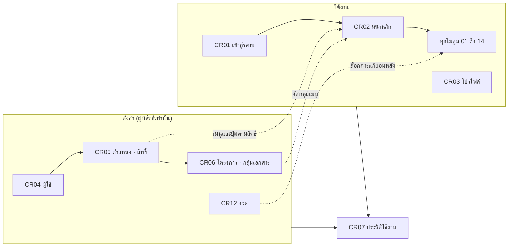
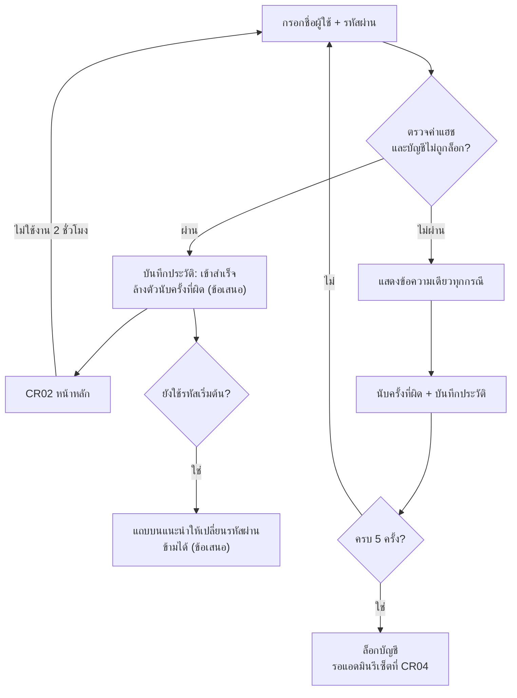
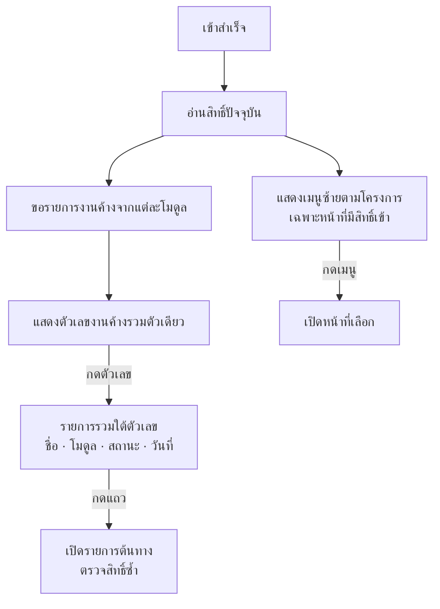
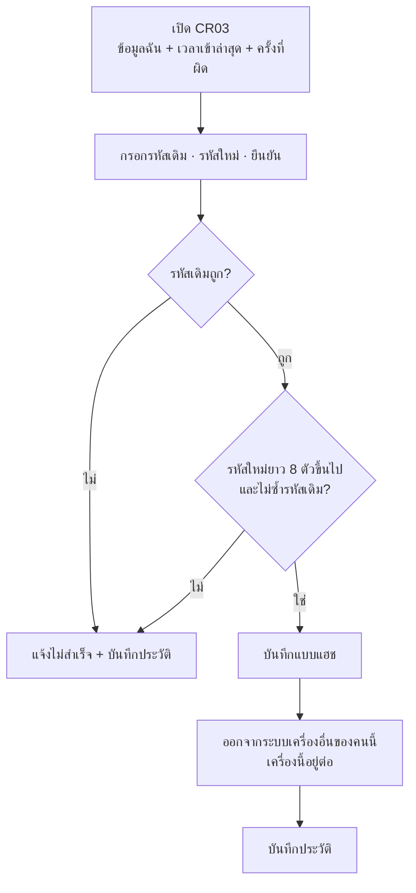
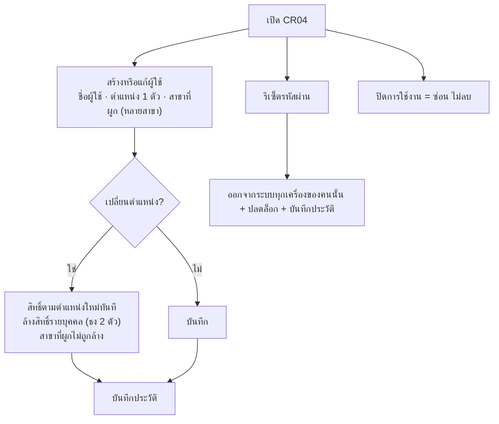
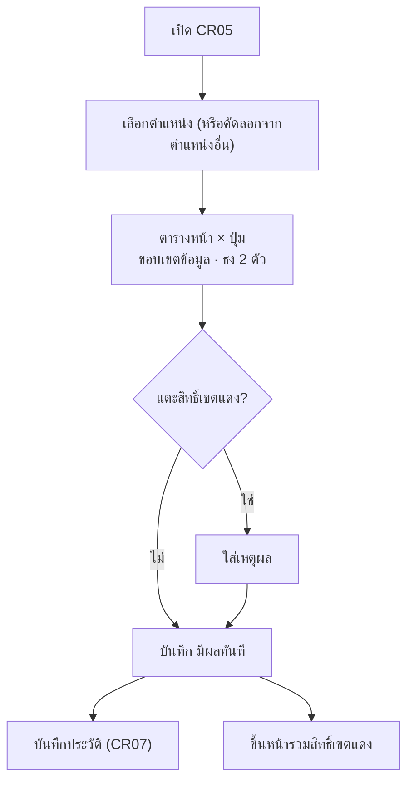
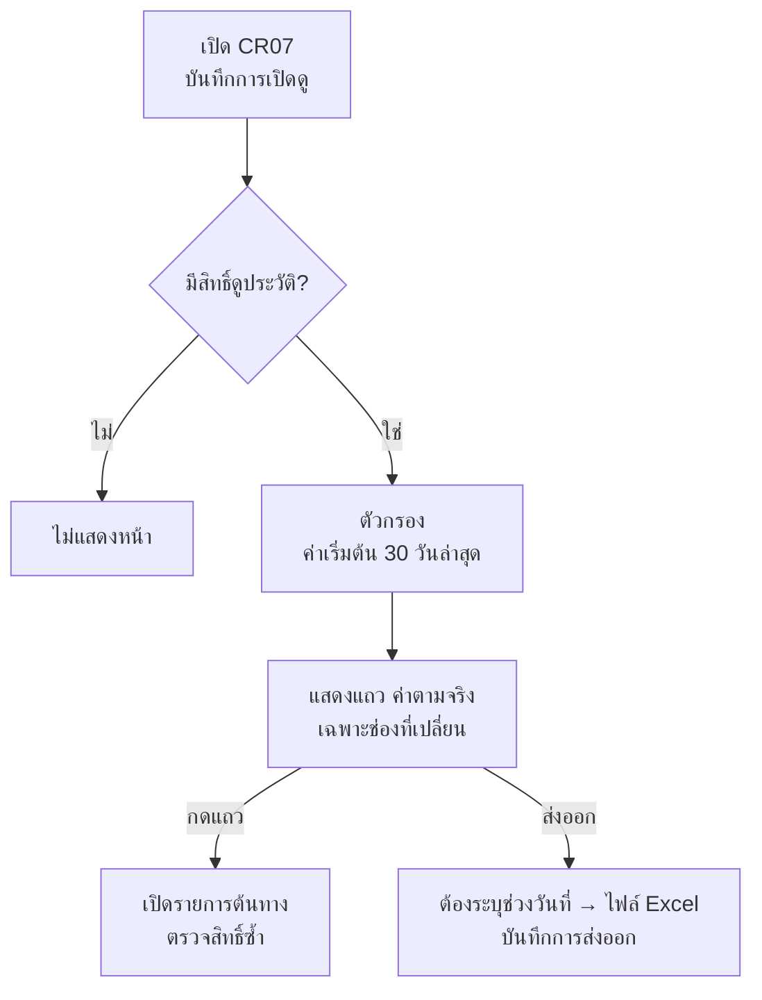
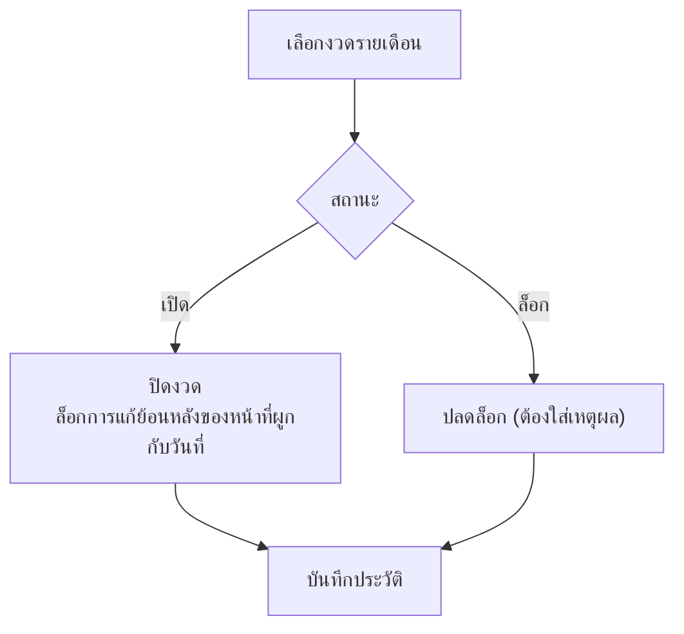

# ระบบกลาง (core)

เฟส: 0 (ต้องเสร็จก่อนโมดูลอื่น)
สถานะ: blueprint ร่าง v1 จาก grill 9 ข้อ (ผู้ใช้ตอบครบ) ยังไม่ลงรายละเอียดหน้า ยังไม่มีโค้ด
ขอบเขต core-A: CR01 เข้าสู่ระบบ · CR02 หน้าหลัก · CR03 โปรไฟล์ · CR04 จัดการผู้ใช้ · CR05 ตำแหน่งและสิทธิ์ · CR06 โครงการ/กลุ่มเอกสาร · CR07 ประวัติใช้งาน · CR12 งวด
core-B (ทำถัดไป): CR08 ถึง CR11 ข้อมูลหลักและการนำเข้า
ไม่มีสูตรคำนวณใน core จึงไม่ต้องผ่าน Formula Gate

## flow ของ core (แผนภาพ)

แสดงเป็นรูปได้ใน GitHub และ Obsidian (เขียนด้วย Mermaid) เน้นขั้นตอนของระบบ ไม่ระบุบทบาท สิทธิ์ตั้งที่ตำแหน่งเท่านั้น

### ภาพรวม

### CR01 เข้าสู่ระบบ

### CR02 หน้าหลัก

### CR03 โปรไฟล์และเปลี่ยนรหัสผ่าน

### CR04 จัดการผู้ใช้

### CR05 ตำแหน่งและสิทธิ์

### CR06 โครงการและกลุ่มเอกสาร

### CR07 ประวัติใช้งาน

### CR12 งวด

## ผล grill 9 ข้อ

| ข้อ | คำตอบ | ผลต่อการออกแบบ |
|---|---|---|
| 1 ใช้ของเดิม | ยืมโครง CF-1 RBAC แล้วเพิ่มส่วนที่ระบบนี้ต้องการ | ใช้รายการตำแหน่งจาก JD 51 ฉบับ และโครงตาราง ตำแหน่ง × หน้า × การกระทำ ฐานข้อมูลแยกจาก ERP Portal |
| 2 การเชื่อมกัน | เปลี่ยนตำแหน่งแล้วสิทธิ์ตามตำแหน่งใหม่ทันที และล้างสิทธิ์รายบุคคลเดิมอัตโนมัติ สิ่งที่เคยทำเก็บเป็นประวัติ ทำย้อนหลังไม่ได้ถ้าสิทธิ์ปัจจุบันไม่อนุญาต | ตรวจสิทธิ์จากค่าปัจจุบันเสมอ |
| 3 ความเข้ม | สิทธิ์เขตแดงต้องใส่เหตุผล และมีหน้ารวมให้ตรวจ | CR05-4, CR05-5 |
| 4 จุดควบคุม | ตั้งสิทธิ์ ผู้ใช้ และรหัสผ่านได้เฉพาะแอดมินที่มีสิทธิ์ จุดเดียว | CR04 CR05 เฉพาะแอดมิน |
| 5 ความละเอียด | สิทธิ์ระดับหน้า × การกระทำ บวกธงข้ามหน้า 2 ตัว (เห็นต้นทุน/กำไร, เห็นข้อมูลส่วนบุคคล) ขอบเขตข้อมูลตั้งที่ ตำแหน่ง × หน้า | CR05-2, CR05-3, CR04-3 |
| 6 หลักฐาน | เหตุผลข้อความอย่างเดียว ไม่ต้องแนบไฟล์ | ไม่มีช่องแนบไฟล์ |
| 7 ความยืดหยุ่น | ผู้ใช้ผูกได้หลายสาขา เห็นรวมทุกสาขาที่ผูก | CR04-2 หลายสาขา สาขาที่ผูกไม่ถูกล้างเมื่อเปลี่ยนตำแหน่ง |
| 8 แบ่งเฟส | ทำครบ 8 หน้าก่อนเปิดโมดูลแรก | ต้องได้ข้อมูลก่อนทำ CR06 และ CR12 |
| 9 เชื่อมเอกสาร | ทุกบรรทัดในประวัติมีลิงก์ไปรายการต้นทาง ตรวจสิทธิ์ซ้ำตอนกด | CR07-2 คอลัมน์ลิงก์ |

## ส่วนที่ 1: ของที่ใช้ซ้ำ

| ของเดิม | ใช้ทำอะไร |
|---|---|
| โครง CF-1 RBAC (`Design Ai/cf1-rbac-permission-mockup.html`, ADR-0006) | ตาราง ตำแหน่ง × หน้า × การกระทำ ไม่มี Role ชั้นกลาง |
| รายการตำแหน่ง JD 51 ฉบับพร้อมรหัสตำแหน่ง | CR05 รายการตำแหน่ง ไม่ตั้งตำแหน่งเอง |
| `Design Ai/_form-template.html` และ artifact Sangwijit Design System | สไตล์ฟอร์ม/ตารางร่วม |

ยังไม่ได้เปิดอ่านเนื้อในไฟล์เหล่านี้ ต้องตรวจก่อนนำมาใช้จริง

## ส่วนที่ 2: กลุ่มข้อมูลและฟิลด์

| รหัส | หน้า | โซนและฟิลด์ |
|---|---|---|
| CR01-1 | เข้าสู่ระบบ | ชื่อผู้ใช้, รหัสผ่าน |
| CR01-2 | | ข้อความเมื่อเข้าไม่สำเร็จ (ข้อความเดียวทุกกรณี) รายละเอียดดูหัวข้อ CR01 ด้านล่าง |
| CR02-0, CR02-1, CR02-2 | หน้าหลัก | แถบบน (ชื่อ ตำแหน่ง สาขาที่ผูก ออกจากระบบ), เมนูซ้ายตามโครงการ, จำนวนงานค้างของฉัน (ไม่แจ้งเตือน) รายละเอียดดูหัวข้อ CR02 ด้านล่าง |
| CR03-1, CR03-2 | โปรไฟล์ | ข้อมูลของฉัน (ตำแหน่ง สาขาที่ผูก เวลาเข้าล่าสุด อ่านอย่างเดียว), เปลี่ยนรหัสผ่านตัวเอง รายละเอียดดูหัวข้อ CR03 ด้านล่าง |
| CR04-1 | จัดการผู้ใช้ | รายการ ค้นหา/กรอง ตามสาขา ตำแหน่ง สถานะ |
| CR04-2 | | ชื่อผู้ใช้, ชื่อ-สกุล, ตำแหน่ง (1 ตัว), สาขาที่ผูก (หลายสาขา), โครงการ, สถานะ |
| CR04-3 | | สิทธิ์รายบุคคล: ธงเห็นต้นทุน/กำไร, ธงเห็นข้อมูลส่วนบุคคล |
| CR04-4 | | รีเซ็ตรหัสผ่าน (ดูรหัสเดิมไม่ได้) |
| CR05-1 | ตำแหน่งและสิทธิ์ | รายการตำแหน่ง (รหัสจาก JD) |
| CR05-2 | | ตารางหน้า × การกระทำ (เข้าได้, ดูอย่างเดียว, แก้ไข, แก้ย้อนหลัง, ยกเลิก, กำหนดกลุ่มเอกสาร) และขอบเขตข้อมูล (ทุกสาขา / สาขาที่ผูก / แผนกตัวเอง) |
| CR05-3 | | ธงของตำแหน่ง (ต้นทุน/กำไร, ข้อมูลส่วนบุคคล) |
| CR05-4 | | เหตุผล (บังคับเมื่อแตะสิทธิ์เขตแดง) |
| CR05-5 | | หน้ารวมสิทธิ์เขตแดงที่ให้ไว้ (เสนอเป็นแท็บใน CR05) |
| CR06-1, CR06-2 | โครงการ/กลุ่มเอกสาร | ชื่อกลุ่ม, เมนูในกลุ่ม, ตำแหน่ง/บุคคลที่เห็น (ตัวอย่างจริงยัง TBD) |
| CR07-1, CR07-2 | ประวัติใช้งาน | ตัวกรอง; แถว: ผู้ทำ, ตำแหน่งตอนนั้น, เวลา, การกระทำ, ช่องที่เปลี่ยน (ค่าก่อน-หลัง), เหตุผล, ลิงก์ต้นทาง รายละเอียดดูหัวข้อ CR07 ด้านล่าง |
| CR12-1, CR12-2 | งวด | รายการงวด (เปิด/ล็อก), ปิดงวด/ปลดล็อก (ต้องใส่เหตุผล) |

## ส่วนที่ 3: ตรรกะใหม่

1. ตรวจสิทธิ์ที่เซิร์ฟเวอร์ทุกการกระทำ จากสิทธิ์ปัจจุบัน
2. ชั้นบุคคลชนะชั้นตำแหน่ง ธงสองตัวใช้ได้ทุกหน้า ผู้ใช้หลายสาขาเห็นรวมเฉพาะสาขาที่ผูก
3. เปลี่ยนตำแหน่ง: สิทธิ์ตามตำแหน่งใหม่ทันที ล้างสิทธิ์รายบุคคลทั้งหมด (รวมธง) บันทึกประวัติและแจ้งบนหน้าจอ แต่สาขาที่ผูกไม่ถูกล้าง
4. สิทธิ์เขตแดงต้องใส่เหตุผลก่อนบันทึก และปรากฏในหน้ารวม
5. CR04 และ CR05 เข้าได้เฉพาะแอดมิน แก้สิทธิ์ตัวเองไม่ได้
6. ทุกการเขียนข้อมูลบันทึกประวัติ (ผู้ทำ ตำแหน่งตอนนั้น ก่อน-หลัง เหตุผล รหัสรายการ+โมดูล) ลิงก์ต้นทางตรวจสิทธิ์ซ้ำตอนกด
7. ลบ = ยกเลิก/ซ่อน งวดล็อกแล้วแก้ย้อนหลังไม่ได้ ปลดล็อกต้องใส่เหตุผล
8. ข้อเสนอที่ผู้ใช้ยังไม่ได้ตกลง: ห้ามถอนสิทธิ์แอดมินคนสุดท้าย

## CR01 เข้าสู่ระบบ: สเปคหน้า (ผู้ใช้ตอบครบแล้ว)

หน้านี้ทำอะไร: เป็นด่านแรกของระบบ ยืนยันว่าผู้ใช้คือใครก่อนให้เห็นเมนูและข้อมูล ทุกคนเข้าหน้านี้ได้โดยไม่ต้องมีสิทธิ์ เพราะยังไม่รู้ว่าเป็นใคร

### ขั้นตอนของระบบ

| ขั้น | สิ่งที่ระบบทำ | คำอธิบาย |
|---|---|---|
| 1 | รับชื่อผู้ใช้และรหัสผ่าน | ผู้ใช้บอกว่าตัวเองคือใคร ชื่อผู้ใช้แอดมินเป็นคนตั้งให้ และไม่ผูกกับอีเมล |
| 2 | ตรวจรหัสผ่านเทียบค่าแฮช และตรวจว่าบัญชีไม่ถูกล็อก | ระบบไม่เก็บรหัสผ่านจริง เก็บเฉพาะค่าที่ย้อนกลับไม่ได้ แม้แอดมินก็ดูรหัสเดิมไม่ได้ |
| 3 | ผ่าน: บันทึกประวัติ ล้างตัวนับครั้งที่ผิด แล้วเข้า CR02 | บันทึกเพื่อตรวจย้อนหลังได้ว่าใครเข้าเมื่อไร ตัวนับเริ่มใหม่เพื่อไม่ให้ความผิดพลาดเก่าสะสม (ข้อเสนอ) |
| 4 | ถ้ายังใช้รหัสเริ่มต้น แถบบนแนะนำให้เปลี่ยนรหัสผ่าน | แอดมินรู้รหัสเริ่มต้น จึงแนะนำให้เจ้าตัวเปลี่ยน ข้ามได้ตามที่ตกลง (ข้อเสนอ) |
| 5 | ไม่ผ่าน: แสดงข้อความเดียว นับครั้งที่ผิด บันทึกประวัติ | ข้อความเดียวเพื่อไม่บอกคนนอกว่าชื่อผู้ใช้นั้นมีอยู่จริง ส่วนการนับเพื่อกันการเดารหัส |
| 6 | ผิดครบ 5 ครั้ง: ล็อกบัญชี | หยุดการเดารหัสผ่าน ปลดได้ด้วยแอดมินรีเซ็ตที่ CR04 เท่านั้น |
| 7 | ไม่ใช้งานครบ 2 ชั่วโมง: ออกจากระบบ | กันคนอื่นใช้ต่อจากเครื่องที่ผู้ใช้ลืมออกจากระบบ ตัวเลขแก้ได้ในหน้าตั้งค่า |

### ส่วนประกอบหน้า

| รหัส | รายการ | คำอธิบาย |
|---|---|---|
| CR01-1 | ช่องชื่อผู้ใช้ | ชื่อที่แอดมินตั้งให้ ไม่ซ้ำกัน ใช้ระบุว่าใครเข้าระบบและตรงกับชื่อในประวัติ |
| CR01-1 | ช่องรหัสผ่าน | ซ่อนตัวอักษรขณะพิมพ์ กันคนข้างหลังมองเห็น |
| CR01-1 | ปุ่ม "เข้าสู่ระบบ" | ปุ่มเดียวบนหน้า ไม่มีทางเลือกอื่นให้สับสน |
| CR01-2 | ข้อความ "เข้าสู่ระบบไม่สำเร็จ หากยังเข้าไม่ได้ติดต่อแอดมิน" | ใช้ข้อความเดียวทุกกรณี (ชื่อผิด รหัสผิด บัญชีล็อก) คนนอกจึงเดาไม่ได้ว่าชื่อใดมีอยู่ และผู้ใช้รู้ว่าต้องติดต่อแอดมิน |
| ไม่มีในหน้า | ลิงก์ลืมรหัสผ่านทางอีเมล | ระบบไม่ผูกอีเมล การกู้บัญชีจึงทำที่แอดมินเท่านั้น ลิงก์นี้จะไม่มีทางทำงาน |
| ไม่มีในหน้า | คำอธิบายยาว โฆษณา | หน้าเรียบตามกรอบดีไซน์ ไม่มีข้อความที่ไม่จำเป็น |

### กฎและค่าตั้งค่า

| เรื่อง | ค่า | สถานะ | คำอธิบาย |
|---|---|---|---|
| ชื่อผู้ใช้ | แอดมินตั้งให้ ต้องไม่ซ้ำ (ไม่ใช้รหัสพนักงานตรงๆ) | ตกลงแล้ว | แอดมินคุมรูปแบบชื่อและไม่ให้ซ้ำ ผู้ใช้ไม่ต้องสมัครเอง |
| ปลดล็อกบัญชี | แอดมินรีเซ็ตเท่านั้น ไม่ปลดเองอัตโนมัติ | ตกลงแล้ว | ไม่มีอีเมลให้กู้บัญชี และการปลดเองอัตโนมัติเปิดช่องให้เดารหัสซ้ำ |
| หมดเวลาการใช้งาน | ไม่ได้ใช้งานครบ 2 ชั่วโมงออกจากระบบ (ค่าตั้งค่า แก้ได้) | ตกลงแล้ว | ข้อมูลต้นทุนและข้อมูลส่วนบุคคลเปิดดูได้ตามสิทธิ์ จึงไม่ควรเปิดค้างนาน นับจากการใช้งานจริง ไม่ใช่เวลาตั้งแต่ล็อกอิน |
| จำนวนครั้งที่ผิดก่อนล็อก | 5 ครั้ง (ค่าตั้งค่า แก้ได้) | ข้อเสนอเริ่มต้น ผู้ใช้ไม่ได้ปฏิเสธ | น้อยพอให้เดารหัสไม่ได้ และมากพอที่คนพิมพ์ผิดธรรมดาไม่โดนล็อกง่าย |
| ล้างตัวนับครั้งที่ผิด | ล้างเมื่อเข้าสำเร็จ | ข้อเสนอ รอยืนยัน | ไม่ให้ความผิดพลาดต่างวันสะสมจนล็อกคนที่ใช้ถูกต้องในที่สุด |
| เตือนก่อนหมดเวลา | แจ้งบนหน้าจอก่อนออก 1 นาที | ข้อเสนอ รอยืนยัน | กันข้อมูลที่กำลังกรอกหายโดยไม่รู้ตัว |
| รหัสผ่าน | เก็บแบบแฮช แอดมินรีเซ็ตได้แต่ดูไม่ได้ | ตกลงแล้ว | ไม่มีใครรวมถึงแอดมินที่รู้รหัสของคนอื่นได้ ประวัติจึงยืนยันตัวตนได้ |
| ผู้เข้าหน้านี้ | ทุกคน (ไม่ต้องมีสิทธิ์) | ตามชีตหน้าและฟังก์ชัน | ยังไม่ได้ล็อกอินจึงยังไม่มีตำแหน่งให้ตรวจสิทธิ์ |

### ประวัติที่บันทึกอัตโนมัติ (CR07)

| เหตุการณ์ | บันทึกอะไร | คำอธิบาย |
|---|---|---|
| เข้าสำเร็จ | ผู้ใช้ เวลา | รู้ว่าใครเข้าเมื่อไร ใช้ตรวจย้อนหลัง |
| เข้าไม่สำเร็จ | ชื่อผู้ใช้ที่พิมพ์ และเวลา ไม่เก็บรหัสผ่านที่พิมพ์ | เห็นความพยายามเข้าที่ผิดปกติโดยไม่เก็บรหัสผ่านซึ่งอาจเป็นรหัสจริงของคนอื่น |
| บัญชีถูกล็อก | ผู้ใช้ เวลา | รู้ว่ามีการเดารหัสหรือพิมพ์ผิดซ้ำเมื่อไร |
| แอดมินรีเซ็ตรหัสผ่าน | ผู้รีเซ็ต เจ้าของบัญชี เวลา | ตรวจได้ว่าใครรีเซ็ตให้ใคร โดยไม่ต้องใส่เหตุผลเพราะเป็นงานประจำ |

CR01 ไม่มีสูตรคำนวณ จึงไม่ต้องผ่าน Formula Gate

## CR02 หน้าหลัก: สเปคหน้า (ผู้ใช้ตอบครบแล้ว)

หน้านี้ทำอะไร: เป็นจุดตั้งต้นหลังเข้าระบบสำเร็จ บอกผู้ใช้ว่าตัวเองเข้าหน้าไหนได้บ้าง และตอนนี้มีงานค้างที่ต้องทำเท่าไร ทุกคนที่ล็อกอินเข้าได้ เป็นเขตเขียว ดูอย่างเดียว

### ขั้นตอนของระบบ

| ขั้น | สิ่งที่ระบบทำ | คำอธิบาย |
|---|---|---|
| 1 | อ่านสิทธิ์ปัจจุบันของผู้ใช้ | ใช้สิทธิ์ตอนนี้เสมอ ไม่ใช้ค่าที่เคยมี จึงถูกต้องแม้เพิ่งเปลี่ยนตำแหน่ง |
| 2 | แสดงเมนูซ้ายตามโครงการ เฉพาะหน้าที่มีสิทธิ์เข้า | ผู้ใช้เห็นเฉพาะที่เกี่ยวกับงานตัวเอง ลดความสับสนและไม่เปิดช่องให้ลองเข้าหน้าที่ไม่ควรเห็น |
| 3 | ขอรายการงานค้างจากแต่ละโมดูล | core ไม่รู้ภายในของโมดูล จึงให้แต่ละโมดูลส่งงานค้างมาให้ตามสิทธิ์ของผู้ใช้ |
| 4 | แสดงตัวเลขงานค้างรวมตัวเดียว | เฟสแรกไม่มีระบบแจ้งเตือน ตัวเลขนี้เป็นทางเดียวที่ผู้ใช้เห็นงานค้างโดยไม่ต้องเปิดทุกโมดูล |
| 5 | กดตัวเลข: แสดงรายการรวมใต้ตัวเลข | ไม่เพิ่มหน้าใหม่ หน้าหลักจึงยังเรียบ |
| 6 | กดแถว: เปิดรายการต้นทางในโมดูลนั้น (ตรวจสิทธิ์ซ้ำ) | ทุกแถวบอกว่ามาจากโมดูลไหน และกันกรณีสิทธิ์เปลี่ยนระหว่างที่หน้านี้เปิดค้าง |

### ส่วนประกอบหน้า

| รหัส | รายการ | คำอธิบาย |
|---|---|---|
| CR02-0 | แถบบน: ชื่อ ตำแหน่ง สาขาที่ผูก ปุ่มออกจากระบบ | เห็นทันทีว่าใครล็อกอินอยู่ กันการทำรายการในชื่อคนอื่นบนเครื่องใช้ร่วม และเห็นขอบเขตข้อมูลที่กำลังใช้ (สำคัญเมื่อผูกหลายสาขา) กดชื่อเข้า CR03 ตัวเล็ก บรรทัดเดียว ใช้ร่วมทุกหน้า |
| CR02-1 | เมนูซ้ายจัดกลุ่มตามโครงการ ย่อและขยายได้ | จอคอมพิวเตอร์กว้างพอ ข้ามไปหน้าอื่นได้ทุกหน้าโดยไม่ต้องกลับหน้าหลัก โครงการที่ไม่มีหน้าที่เข้าได้จะไม่ขึ้น ใช้ร่วมทุกหน้า |
| CR02-2 | ตัวเลข "งานค้างของฉัน" | นับเฉพาะงานที่ตำแหน่งนี้มีสิทธิ์ทำ ตัวเลขรวมตัวเดียวเพื่อให้เรียบ ไม่แจ้งเตือน ผู้ใช้เปิดมาดูเอง |
| CR02-2 | แถวในรายการรวม: ชื่อรายการ โมดูลต้นทาง สถานะ วันที่ | บอกว่าเป็นงานอะไร มาจากโมดูลไหน รออะไร และเมื่อไร ผู้ใช้ตัดสินใจได้โดยไม่ต้องเปิดแต่ละรายการก่อน |
| ปุ่ม | "ดู" อย่างเดียว | หน้านี้เป็นทางผ่านและรายงานสั้นๆ การแก้ไขทำในโมดูลต้นทาง ไม่มีเพิ่ม แก้ ยกเลิก |

### สัญญากับโมดูลอื่น

| รายการ | ค่า | คำอธิบาย |
|---|---|---|
| แถวงานค้างที่โมดูลส่งให้ core | 1 แถวต่อ 1 รายการ ประกอบด้วย รหัสรายการ ชื่อ สถานะ วันที่ โมดูล | ทำให้ core รวมและเรียงได้โดยไม่ต้องรู้โครงสร้างภายในของแต่ละโมดูล |
| นิยาม "งานค้าง" | แต่ละโมดูลกำหนดเอง (เช่น รอตรวจ ส่งกลับมาให้แก้ ใกล้หมดอายุ) | งานค้างของคอมมิชชั่นกับของคลังไม่เหมือนกัน จึงให้เจ้าของโมดูลตัดสิน ไม่ตัดสินที่ CR02 |
| การเรียงรายการรวม | วันที่รอนานสุดขึ้นก่อน (ข้อเสนอ รอยืนยัน) | งานที่ค้างนานที่สุดมักเสี่ยงที่สุด ควรเห็นก่อน |

### กฎและสถานะ

| เรื่อง | ค่า | สถานะ | คำอธิบาย |
|---|---|---|---|
| ตัวเลขงานค้าง | รวมตัวเดียว | ตกลงแล้ว | เรียบที่สุด รายละเอียดอยู่ในรายการรวมใต้ตัวเลข |
| รายการรวม | อยู่ใต้ตัวเลขบน CR02 ไม่เพิ่มหน้าใหม่ | ตกลงแล้ว | ไม่เพิ่มหน้าให้ core ถ้ารายการยาวมากค่อยแยกหน้าภายหลังได้ |
| เมนู | ด้านซ้ายทุกหน้า จัดกลุ่มตามโครงการ | ตกลงแล้ว | จอคอมพิวเตอร์มาก่อน ตรงกับการจัดกลุ่มโครงการใน CR06 |
| แถบบน | ชื่อ ตำแหน่ง สาขาที่ผูก ออกจากระบบ | ตกลงแล้ว | ดูเหตุผลที่ CR02-0 |
| มือถือ | เมนูซ้ายพับเป็นปุ่มเมนู | เฟสมือถือ ทำทีหลัง | กรอบดีไซน์ให้คอมพิวเตอร์ก่อน |
| ผู้เข้าหน้านี้ | ทุกคนที่ล็อกอิน เขตเขียว | ตามชีตหน้าและฟังก์ชัน | หน้านี้เป็นทางผ่าน เนื้อหาในหน้ากรองตามสิทธิ์อยู่แล้ว |

CR02 ไม่มีสูตรคำนวณ และโครงสร้างโครงการจริงมาจาก CR06 (ยังรอตัวอย่างจากผู้ใช้)

## CR03 โปรไฟล์: สเปคหน้า (ผู้ใช้ตอบครบแล้ว)

หน้านี้ทำอะไร: ให้ผู้ใช้ดูข้อมูลของตัวเอง และเปลี่ยนรหัสผ่านของตัวเองได้ เป็นเขตแดง ทุกคนที่ล็อกอินเข้าได้ แต่เห็นเฉพาะข้อมูลของตัวเอง

### ขั้นตอนของระบบ

| ขั้น | สิ่งที่ระบบทำ | คำอธิบาย |
|---|---|---|
| 1 | แสดงข้อมูลของฉัน (อ่านอย่างเดียว) | ตำแหน่งและสาขาเปลี่ยนที่นี่ไม่ได้ เพราะแอดมินเป็นผู้กำหนดเพื่อคุมสิทธิ์ |
| 2 | รับรหัสเดิม รหัสใหม่ และยืนยันรหัสใหม่ | ต้องรู้รหัสเดิมจึงเปลี่ยนได้ กันคนที่นั่งเครื่องที่ลืมออกจากระบบมาเปลี่ยนรหัสของเจ้าของ |
| 3 | ตรวจรหัสเดิมเทียบค่าแฮช | ระบบไม่เก็บรหัสผ่านจริง จึงเทียบด้วยค่าที่ย้อนกลับไม่ได้ |
| 4 | ตรวจกฎรหัสใหม่: ยาว 8 ตัวขึ้นไป และไม่ซ้ำรหัสเดิม | ความยาวช่วยกันการเดามากกว่าการบังคับสัญลักษณ์ ซึ่งทำให้คนตั้งรหัสเดาง่ายแบบ abcd1234 |
| 5 | บันทึกรหัสใหม่แบบแฮช | ไม่มีใครรวมถึงแอดมินที่รู้รหัสใหม่ของคนอื่นได้ |
| 6 | ออกจากระบบเครื่องอื่นของคนนี้ เครื่องนี้อยู่ต่อ | รหัสเก่าที่ค้างเปิดในเครื่องใช้ร่วมหมดผลทันที โดยผู้ใช้ไม่ต้องล็อกอินซ้ำที่เครื่องนี้ |
| 7 | บันทึกประวัติ | ตรวจย้อนหลังได้ว่าเปลี่ยนรหัสเมื่อไร (ไม่เก็บตัวรหัสผ่าน) |

### ส่วนประกอบหน้า

| รหัส | รายการ | คำอธิบาย |
|---|---|---|
| CR03-1 | ชื่อผู้ใช้ และชื่อ-สกุล (อ่านอย่างเดียว) | ยืนยันว่ากำลังล็อกอินด้วยบัญชีของใคร |
| CR03-1 | ตำแหน่ง และสาขาที่ผูก (อ่านอย่างเดียว) | บอกขอบเขตข้อมูลที่ตัวเองเห็น โดยเฉพาะเมื่อผูกหลายสาขา |
| CR03-1 | เวลาเข้าล่าสุด และจำนวนครั้งที่ผิดตั้งแต่เข้าครั้งก่อน | ช่วยให้ผู้ใช้สังเกตเองว่ามีคนใช้บัญชีของตัวเองหรือไม่ สำคัญเพราะไม่บังคับเปลี่ยนรหัสเริ่มต้น |
| CR03-2 | ช่องรหัสเดิม | ต้องรู้รหัสเดิมจึงเปลี่ยนได้ |
| CR03-2 | ช่องรหัสใหม่ และช่องยืนยันรหัสใหม่ | ช่องยืนยันกันพิมพ์ผิดจนเข้าระบบไม่ได้ |
| CR03-2 | ปุ่ม "เปลี่ยนรหัสผ่าน" | ปุ่มเดียวของหน้านี้ที่เปลี่ยนข้อมูลได้ |
| ไม่มีในหน้า | เปลี่ยนชื่อผู้ใช้ ตำแหน่ง สาขา หรืออีเมลเอง | แอดมินเป็นผู้กำหนดเพื่อให้สิทธิ์คุมได้จากจุดเดียว ส่วนอีเมลระบบไม่ผูกอยู่แล้ว |

### กฎและสถานะ

| เรื่อง | ค่า | สถานะ | คำอธิบาย |
|---|---|---|---|
| กฎรหัสผ่านใหม่ | ยาวอย่างน้อย 8 ตัว (ค่าตั้งค่า แก้ได้) ไม่บังคับชนิดตัวอักษร ต้องไม่ซ้ำรหัสเดิม | ตกลงแล้ว | ความยาวสำคัญกว่าสัญลักษณ์ และมีการล็อกบัญชีกันการเดาอยู่แล้ว |
| รหัสเริ่มต้นที่แอดมินตั้งหรือรีเซ็ต | แนะนำให้เปลี่ยนแต่ข้ามได้ ใช้ต่อได้ | ตกลงแล้ว | ไม่บังคับเพื่อให้เริ่มงานได้ทันที |
| ข้อสังเกตของข้อบน | ถ้าผู้ใช้ไม่เปลี่ยน แอดมินที่รู้รหัสเริ่มต้นเข้าในชื่อคนนั้นได้ ประวัติ CR07 ยืนยันตัวตนได้ไม่เต็มที่ | บันทึกไว้ ไม่ใช่ข้อห้าม | เป็นข้อแลกที่ผู้ใช้เลือก จึงมีการแสดงเวลาเข้าล่าสุดมาชดเชย |
| หลังเปลี่ยนรหัสสำเร็จ | ออกจากระบบเฉพาะเครื่องอื่น เครื่องนี้อยู่ต่อ | ตกลงแล้ว | ปิดช่องรหัสเก่าที่ค้างเปิดโดยไม่รบกวนผู้ใช้ |
| แอดมินรีเซ็ตรหัสผ่านให้ผู้ใช้ | ทุกเครื่องของคนนั้นถูกออกจากระบบ | ตกลงแล้ว | รีเซ็ตมักเกิดตอนสงสัยว่ารหัสรั่ว จึงต้องตัดทุกเครื่องทันที |
| ประวัติเข้าของตัวเอง | แสดงเวลาเข้าล่าสุดและจำนวนครั้งที่ผิดตั้งแต่เข้าครั้งก่อน | ตกลงแล้ว | ต้นทุนต่ำมากและช่วยให้ผู้ใช้เป็นคนแรกที่รู้ว่ามีการเข้าที่ผิดปกติ ไม่ต้องรอแจ้งเตือน (เฟสแรกไม่มี) |
| ข้อความแนะนำเปลี่ยนรหัสผ่านเริ่มต้น | แสดงที่แถบบนจนกว่าจะเปลี่ยน | ข้อเสนอ รอยืนยัน | ทำให้การแนะนำไม่ถูกลืมโดยไม่บังคับ |
| ผู้เข้าหน้านี้ | ทุกคนที่ล็อกอิน เห็นเฉพาะข้อมูลตัวเอง เขตแดง | ตามชีตหน้าและฟังก์ชัน | หน้านี้เป็นของแต่ละบุคคล ไม่ต้องใช้สิทธิ์ตำแหน่ง |

### ประวัติที่บันทึกอัตโนมัติ (CR07)

| เหตุการณ์ | บันทึกอะไร | คำอธิบาย |
|---|---|---|
| เปลี่ยนรหัสผ่านสำเร็จ | ผู้ใช้ เวลา | รู้ว่าเปลี่ยนเมื่อไร ไม่เก็บตัวรหัสผ่านทั้งเก่าและใหม่ |
| เปลี่ยนไม่สำเร็จ | ผู้ใช้ เวลา เหตุผลที่ไม่ผ่าน (เช่น รหัสเดิมผิด) | เห็นความพยายามที่ผิดปกติ โดยไม่เก็บรหัสที่พิมพ์ |
| ออกจากระบบเครื่องอื่น | ผู้ใช้ เวลา จำนวนเครื่องที่ถูกออก | ตรวจได้ว่าการเปลี่ยนรหัสตัดเครื่องไหนไปบ้าง |

CR03 ไม่มีสูตรคำนวณ

## CR07 ประวัติใช้งาน: สเปคหน้า (ผู้ใช้ตอบครบแล้ว)

หน้านี้ทำอะไร: ให้ผู้ที่มีสิทธิ์ตรวจย้อนหลังว่าใครทำอะไรกับรายการไหน เมื่อไร และเปลี่ยนค่าอะไร เป็นเขตแดง ดูอย่างเดียว แก้หรือลบไม่ได้

### ขั้นตอนของระบบ

| ขั้น | สิ่งที่ระบบทำ | คำอธิบาย |
|---|---|---|
| 1 | บันทึกว่ามีคนเปิด CR07 | หน้านี้แสดงค่าตามจริง รวมต้นทุนและข้อมูลส่วนบุคคล การเปิดดูจึงต้องมีร่องรอย |
| 2 | ตรวจสิทธิ์ดูประวัติ | ไม่มีสิทธิ์ก็ไม่แสดงหน้านี้ และตั้งขอบเขตสาขา/แผนกได้ที่ตารางสิทธิ์ตำแหน่ง |
| 3 | แสดงตัวกรอง ค่าเริ่มต้น 30 วันล่าสุด | ประวัติเก็บตลอด หน้าจอจึงเปิดช่วงล่าสุดก่อนเพื่อไม่ให้ช้า (ตัวเลข 30 วันเป็นข้อเสนอ) |
| 4 | แสดงแถวประวัติ ค่าก่อน-หลังตามจริง | ผู้มีสิทธิ์ดูประวัติต้องเห็นว่าเปลี่ยนอะไรจริงจึงตรวจสอบได้ |
| 5 | กดแถว: เปิดรายการต้นทางในโมดูลนั้น (ตรวจสิทธิ์ซ้ำ) | ไปดูบริบทของรายการได้ทันที และกันกรณีผู้กดไม่มีสิทธิ์ดูรายการนั้น |
| 6 | ส่งออก: ต้องระบุช่วงวันที่ แล้วออกเป็นไฟล์ Excel | ป้องกันการส่งออกประวัติทั้งหมดโดยไม่ตั้งใจ ค่าในไฟล์เหมือนที่เห็นในหน้า |
| 7 | บันทึกการส่งออก | ตรวจได้ว่าใครส่งข้อมูลออกเมื่อไรและช่วงไหน |

### ส่วนประกอบหน้า

| รหัส | รายการ | คำอธิบาย |
|---|---|---|
| CR07-1 | ตัวกรอง: ผู้ใช้ | ดูว่าคนนี้ทำอะไรบ้าง |
| CR07-1 | ตัวกรอง: ช่วงวันที่ | จำกัดช่วงที่ต้องตรวจ และเป็นเงื่อนไขของการส่งออก |
| CR07-1 | ตัวกรอง: โมดูล/โปรแกรม | ดูเฉพาะเรื่องที่เกี่ยวกับโมดูลใดโมดูลหนึ่ง |
| CR07-1 | ตัวกรอง: การกระทำ (มี "ดู" แยกจากการแก้) | แยกการเปิดดูข้อมูลอ่อนไหวออกจากการแก้ไข ไม่ให้ปะปนตอนตรวจ |
| CR07-2 | ผู้ทำ | รู้ว่าใครเป็นคนทำ |
| CR07-2 | ตำแหน่งตอนนั้น | ตำแหน่งที่มีในเวลาที่ทำ ไม่ใช่ตำแหน่งปัจจุบัน เพราะคนย้ายตำแหน่งแล้วยังต้องรู้ว่าตอนนั้นทำในฐานะอะไร |
| CR07-2 | เวลา | ลำดับเหตุการณ์ |
| CR07-2 | การกระทำ | เพิ่ม แก้ ยกเลิก เข้าสู่ระบบ ดู ส่งออก ฯลฯ |
| CR07-2 | ช่องที่เปลี่ยน: ชื่อช่อง ค่าก่อน ค่าหลัง | เก็บเฉพาะช่องที่เปลี่ยนเพื่ออ่านง่าย ไม่เก็บภาพทั้งรายการเพราะระบบไม่มีฟังก์ชันย้อนค่ากลับ |
| CR07-2 | เหตุผล | มีเมื่อการกระทำนั้นบังคับให้ใส่ เช่น ส่งกลับ ปลดล็อกงวด ให้สิทธิ์เขตแดง |
| CR07-2 | ลิงก์ไปรายการต้นทาง | ทุกแถวบอกว่ามาจากรายการไหนในโมดูลไหน |
| ปุ่ม | ดู, ส่งออก | ไม่มีแก้ ลบ ยกเลิก เพราะประวัติต้องไม่ถูกแก้ |

### กฎและสถานะ

| เรื่อง | ค่า | สถานะ | คำอธิบาย |
|---|---|---|---|
| ผู้เข้าหน้านี้ | ตามสิทธิ์ "ดูประวัติ" ขอบเขตสาขา/แผนกตั้งที่ตารางสิทธิ์ตำแหน่ง | ตกลงแล้ว | ใครเห็นประวัติของใครเป็นเรื่องสิทธิ์ ตั้งที่จุดเดียว |
| ค่าอ่อนไหวในแถว | แสดงค่าตามจริง รวมต้นทุนและข้อมูลส่วนบุคคล ให้ทุกคนที่มีสิทธิ์ดูประวัติ | ตกลงแล้ว | ผู้ตรวจสอบต้องเห็นค่าจริงจึงตรวจได้ ซ่อนค่าทำให้ตรวจย้อนหลังไม่ได้ |
| ผลข้างเคียงของข้อบน | สิทธิ์ดูประวัติข้ามธงต้นทุนและธงข้อมูลส่วนบุคคลได้ จึงถือเป็นสิทธิ์เขตแดงใน CR05 (ต้องใส่เหตุผล ขึ้นหน้ารวม) | ข้อเสนอ รอยืนยัน | ปิดช่องที่คนที่ไม่ควรเห็นต้นทุนจะเห็นผ่านประวัติ |
| การเก็บ | เก็บตลอด ไม่ลบจริง | ตกลงแล้ว | ตรงกับกฎ "ลบ = ยกเลิก/ซ่อน ทุกการเปลี่ยนแปลงมีประวัติ" |
| ช่วงเริ่มต้นของหน้า | เปิดช่วงล่าสุด 30 วัน ช่วงเก่ากว่านั้นเลือกวันที่เอง | ตกลงหลักการ ตัวเลข 30 วันเป็นข้อเสนอ | แก้ปัญหาหน้าช้าด้วยตัวกรองแทนการลบข้อมูล |
| ค่าก่อน-หลัง | เฉพาะช่องที่เปลี่ยน ไม่เก็บภาพทั้งรายการ ไม่เก็บรหัสผ่านทุกชนิด | ตกลงแล้ว | อ่านง่าย และไม่เก็บรหัสผ่านซึ่งอาจเป็นรหัสจริงของคนอื่น |
| การเปิดดู | บันทึกเฉพาะหน้าที่มีต้นทุน/กำไร ข้อมูลส่วนบุคคล และ CR07 หนึ่งแถวต่อการเปิดหนึ่งหน้า ไม่เก็บค่าที่เห็น | ตกลงแล้ว | ข้อมูลรั่วได้ง่ายที่สุดตอนเปิดดู จึงบันทึกเฉพาะจุดเสี่ยงโดยไม่ท่วมประวัติ |
| ส่งออก | ตามตัวกรอง ต้องระบุช่วงวันที่ ไฟล์ Excel (.xlsx) ค่าเหมือนที่เห็นในหน้า บันทึกการส่งออก | ตกลงแล้ว | ช่องที่ข้อมูลออกจากระบบครั้งละมากๆ จึงต้องมีเบรกเล็กๆ และร่องรอย |
| เพดานแถวต่อไฟล์ส่งออก | ไม่กำหนด | ยังไม่ได้ขอ | ถ้าต้องการเพดานบอกได้ |
| นำเข้าจากชีต (CR11) | บันทึกหนึ่งแถวต่อการดึงหนึ่งครั้ง (เวลา จำนวนแถวใหม่ ผลลัพธ์) ไม่บันทึกทีละแถวธุรกรรม | ข้อเสนอ รอยืนยัน | ข้อมูลที่ถูกดึงเป็นข้อมูล ไม่ใช่การกระทำของผู้ใช้ ไม่งั้นประวัติจะท่วมจนอ่านไม่ได้ |

CR07 ไม่มีสูตรคำนวณ และเป็นเขตแดง

## ร่างโครง CR04 CR05 CR06 CR12 (ผู้ใช้จะแก้รายละเอียดทีหลัง)

ทุกข้อในหัวข้อนี้เป็นค่าเริ่มต้นที่ผมเสนอ ติดป้ายว่า "ตกลงแล้ว" เมื่อมาจากคำตอบของผู้ใช้ และ "ข้อเสนอ" เมื่อเป็นค่าที่ผมเสนอเอง ทุกรายการมีคอลัมน์คำอธิบาย

### CR04 จัดการผู้ใช้

หน้านี้ทำอะไร: เป็นที่เดียวสำหรับสร้าง แก้ ปิดผู้ใช้ ตั้งสิทธิ์รายบุคคล และรีเซ็ตรหัสผ่าน เข้าได้เฉพาะผู้มีสิทธิ์แอดมิน (เขตแดง)

#### ขั้นตอนของระบบ

| ขั้น | สิ่งที่ระบบทำ | คำอธิบาย |
|---|---|---|
| 1 | แสดงรายการผู้ใช้ ค้นหาและกรองตามสาขา ตำแหน่ง สถานะ | หาคนที่ต้องการได้เร็ว |
| 2 | เลือกหรือสร้างผู้ใช้ แล้วกรอกข้อมูล | ชื่อผู้ใช้ ชื่อ-สกุล ตำแหน่ง สาขาที่ผูก โครงการ สถานะ |
| 3 | บันทึกและบันทึกประวัติ | ทุกการเปลี่ยนแปลงต้องมีร่องรอยตามกฎกลาง |
| 4 | ถ้าเปลี่ยนตำแหน่ง: สิทธิ์ตามตำแหน่งใหม่ทันที และล้างสิทธิ์รายบุคคล | สิทธิ์ผูกกับตำแหน่ง คนที่ย้ายไม่ควรถือสิทธิ์เก่า ส่วนสาขาที่ผูกไม่ถูกล้าง |
| 5 | รีเซ็ตรหัสผ่าน: ออกจากระบบทุกเครื่องของคนนั้นและปลดล็อก | รีเซ็ตมักเกิดตอนสงสัยว่ารหัสรั่ว หรือบัญชีถูกล็อกจนเข้าไม่ได้ |
| 6 | ปิดการใช้งาน | ซ่อน ไม่ลบ เพื่อให้ประวัติยังชี้ถึงคนนั้นได้ |

#### ส่วนประกอบหน้า

| รหัส | รายการ | สถานะ | คำอธิบาย |
|---|---|---|---|
| CR04-1 | รายการ ค้นหาและกรอง | ตกลงแล้ว | ผู้ใช้อาจมีหลายสิบถึงหลายร้อยคน ต้องหาได้เร็ว |
| CR04-2 | ชื่อผู้ใช้ (แอดมินตั้ง ไม่ซ้ำ) | ตกลงแล้ว | แอดมินคุมรูปแบบและไม่ให้ซ้ำ ผู้ใช้ไม่ต้องสมัครเอง |
| CR04-2 | ชื่อ-สกุล | ตกลงแล้ว | ให้คนอ่านประวัติรู้ว่าเป็นใคร |
| CR04-2 | ตำแหน่ง 1 ตัว | ตกลงแล้ว | 1 คนมี 1 ตำแหน่ง สิทธิ์ทั้งหมดมาจากตำแหน่งนี้ |
| CR04-2 | สาขาที่ผูก (หลายสาขา) | ตกลงแล้ว | คนดูแลหลายสาขาเห็นรวมเฉพาะสาขาที่ผูก ไม่เห็นเกิน |
| CR04-2 | โครงการ | ตกลงแล้ว | กำหนดกลุ่มเมนูที่เห็นใน CR02 |
| CR04-2 | สถานะใช้งาน/ปิด | ตกลงแล้ว | ปิดแทนการลบ |
| CR04-3 | ธงเห็นต้นทุน/กำไร และธงเห็นข้อมูลส่วนบุคคล | ตกลงแล้ว | สิทธิ์รายบุคคลที่ข้ามหน้า ล้างเมื่อเปลี่ยนตำแหน่ง และขึ้นหน้ารวมเขตแดง |
| CR04-4 | ปุ่มรีเซ็ตรหัสผ่าน (ดูรหัสเดิมไม่ได้) | ตกลงแล้ว | แอดมินตั้งรหัสใหม่ให้ได้ แต่ไม่รู้รหัสที่ผู้ใช้เปลี่ยนเอง |
| รหัสเริ่มต้น | ระบบสุ่มให้และแสดงครั้งเดียวตอนสร้างหรือรีเซ็ต | ข้อเสนอ | ไม่ต้องให้แอดมินคิดรหัสเอง และไม่มีรหัสซ้ำกันหลายคน |
| ปิดการใช้งาน | ออกจากระบบทันที ประวัติยังอยู่ ไม่ใช้ชื่อผู้ใช้ซ้ำ | ซ่อน ไม่ลบ ตกลงแล้ว ที่เหลือข้อเสนอ | ป้องกันคนที่ออกจากงานยังเข้าระบบได้ และกันชื่อซ้ำทำให้ประวัติสับสน |
| ปุ่ม | เพิ่ม, แก้ไข, ปิดใช้งาน, รีเซ็ตรหัสผ่าน, ตั้งสิทธิ์รายบุคคล | ตามชีต | ปุ่มทั้งหมดตั้งสิทธิ์ได้ที่ CR05 |

### CR05 ตำแหน่งและสิทธิ์

หน้านี้ทำอะไร: ตั้งว่าแต่ละตำแหน่งเข้าหน้าไหน กดปุ่มไหนได้ และเห็นข้อมูลของใครบ้าง เป็นหัวใจของสิทธิ์ทั้งระบบ เข้าได้เฉพาะผู้มีสิทธิ์แอดมิน (เขตแดง)

#### ขั้นตอนของระบบ

| ขั้น | สิ่งที่ระบบทำ | คำอธิบาย |
|---|---|---|
| 1 | เลือกตำแหน่ง (หรือสร้างใหม่โดยคัดลอกจากตำแหน่งอื่น) | ตำแหน่งใหม่เริ่มจากตำแหน่งที่ใกล้เคียงแล้วแก้ ลดงานติ๊กหลายสิบหน้า |
| 2 | แสดงตารางหน้า × ปุ่ม พร้อมขอบเขตข้อมูลและธง | ตั้งสิทธิ์ที่มุมมองตำแหน่งเท่านั้น เพื่อให้มีจุดตั้งจุดเดียว |
| 3 | ผู้ใช้ติ๊กสิทธิ์ | ปุ่มของแต่ละหน้าระบบสร้างรายการให้เองจากการออกแบบหน้า |
| 4 | ถ้าแตะสิทธิ์เขตแดง ต้องใส่เหตุผล | บังคับให้คิดก่อนให้สิทธิ์ที่เสี่ยง และเก็บเหตุผลไว้ตรวจย้อนหลัง |
| 5 | บันทึก มีผลทันที | สิทธิ์เป็นค่าปัจจุบันเสมอ ไม่มีสถานะรอ |
| 6 | บันทึกประวัติ และขึ้นหน้ารวมสิทธิ์เขตแดง | ผู้ตรวจสอบเปิดดูทั้งหมดได้ในที่เดียว |

#### ส่วนประกอบหน้า

| รหัส | รายการ | สถานะ | คำอธิบาย |
|---|---|---|---|
| CR05-1 | รายการตำแหน่ง: รหัสและชื่อจากรายการเดิม 51 ฉบับ เพิ่มหรือยกเลิกตำแหน่งได้ | ตกลงแล้ว | ไม่คิดตำแหน่งขึ้นใหม่ ใช้ชุดเดียวกับเอกสารอบรมและ JD |
| CR05-1 | ยกเลิกตำแหน่งที่ยังมีคนอยู่ไม่ได้ | ข้อเสนอ | กันคนที่ไม่มีตำแหน่งจนเข้าระบบไม่ได้ |
| CR05-2 | ตารางสิทธิ์: คอลัมน์คือปุ่มของแต่ละหน้า ปุ่มสามัญจัดเป็นกลุ่ม | ตกลงแล้ว | ให้แยกได้ เช่น "อนุมัติ" ได้แต่ "บันทึกการจ่าย" ไม่ได้ |
| CR05-2 | ขอบเขตข้อมูลต่อหน้า: ทุกสาขา / สาขาที่ผูก / แผนกตัวเอง | ตกลงแล้ว | คนเดียวกันอาจเห็นทุกสาขาในหน้าหนึ่งแต่เฉพาะสาขาตัวเองในอีกหน้า |
| CR05-3 | ธงของตำแหน่ง: เห็นต้นทุน/กำไร, เห็นข้อมูลส่วนบุคคล | ตกลงแล้ว | ครอบคลุมสองเรื่องที่เสี่ยงที่สุดทุกหน้า ตั้งครั้งเดียวไม่ต้องไล่ทีละหน้า |
| CR05-4 | ช่องเหตุผล (บังคับเมื่อแตะสิทธิ์เขตแดง) | ตกลงแล้ว | เก็บเหตุผลไว้ตรวจ ไม่บังคับแนบไฟล์ |
| CR05-5 | หน้ารวมสิทธิ์เขตแดงที่ให้ไว้ทั้งหมด | หน้ารวมตกลงแล้ว | ให้ผู้ตรวจสอบเห็นภาพรวมโดยไม่ต้องเปิดทีละตำแหน่ง |
| CR05-5 | หน้ารวมเป็นแท็บใน CR05 | ข้อเสนอ | ไม่เพิ่มหน้าให้ core |
| สิทธิ์เขตแดง | เห็นต้นทุน/กำไร, เห็นข้อมูลส่วนบุคคล, ดูประวัติ (CR07), ปลดล็อกงวด, KPI ที่ผูกค่าตอบแทน | เขตแดงตกลงแล้ว ดูประวัติและปลดล็อกงวดเป็นข้อเสนอ | สองรายการหลังเป็นข้อเสนอเพราะข้ามธงหรือแก้ย้อนหลังได้ |
| วิธีตั้ง | ตั้งทีละตำแหน่ง คัดลอกสิทธิ์จากตำแหน่งอื่นได้ มีมุมมองกลับด้านอ่านอย่างเดียว | ข้อเสนอ | ตั้งที่จุดเดียวกันตั้งผิด ส่วนมุมมองกลับด้านตอบว่า "หน้านี้ใครเข้าได้" |
| ตำแหน่งใหม่ | เริ่มโดยไม่มีสิทธิ์ใดเลย | ข้อเสนอ | ปลอดภัยกว่าเปิดไว้ก่อนแล้วค่อยปิด |
| มีผล | ทันทีที่บันทึก | ข้อเสนอ | ไม่ให้เกิดช่วงที่สิทธิ์ที่เห็นไม่ตรงกับที่ตั้ง |
| ข้อห้าม | แก้สิทธิ์ตัวเองไม่ได้ | ตกลงแล้ว | กันการให้สิทธิ์ตัวเองโดยไม่มีคนอื่นรู้ |
| ข้อห้าม | ห้ามถอนแอดมินคนสุดท้าย | ข้อเสนอ | กันไม่ให้ไม่เหลือใครเข้า CR04 และ CR05 ได้ |

### CR06 โครงการ/กลุ่มเอกสาร

หน้านี้ทำอะไร: จัดกลุ่มหน้าเป็นโครงการเพื่อให้เมนูของแต่ละคนมีเฉพาะส่วนที่เกี่ยวข้อง และจัดกลุ่มเอกสารเพื่อกำหนดว่าตำแหน่งหรือบุคคลไหนเห็นเอกสารกลุ่มไหน (เขตเหลือง)

#### ขั้นตอนของระบบ

| ขั้น | สิ่งที่ระบบทำ | คำอธิบาย |
|---|---|---|
| 1 | สร้างหรือแก้โครงการ: ชื่อ + หน้าในโครงการ | ให้เมนูใน CR02 จัดกลุ่มตามงานจริงของผู้ใช้ |
| 2 | สร้างหรือแก้กลุ่มเอกสาร: ชื่อ + ตำแหน่งหรือบุคคลที่เห็น | แยกเอกสารที่ไม่ควรเปิดให้ทุกคนเห็นออกเป็นกลุ่ม |
| 3 | บันทึกและบันทึกประวัติ | การจัดกลุ่มเปลี่ยนว่าใครเห็นอะไร จึงต้องมีร่องรอย |

#### ส่วนประกอบหน้า

| รหัส | รายการ | สถานะ | คำอธิบาย |
|---|---|---|---|
| CR06-1 | โครงการ: ชื่อ รายการหน้าในโครงการ | ตกลงหลักการ | ใช้จัดกลุ่มเมนู ไม่ใช่การให้สิทธิ์ สิทธิ์ยังตั้งที่ CR05 |
| CR06-2 | กลุ่มเอกสาร: ชื่อ ตำแหน่ง/บุคคลที่เห็นเอกสารกลุ่มนั้น | ตกลงหลักการ | แยกการเห็นเอกสารระดับกลุ่ม ซึ่งละเอียดกว่าสิทธิ์ระดับหน้า |
| สิทธิ์ | "กำหนดกลุ่มเอกสาร" เป็นปุ่มแยกในตารางสิทธิ์ (CR05) | ตามชีต | ให้คนที่จัดกลุ่มได้เป็นเฉพาะตำแหน่งที่ตั้งไว้ |
| ตัวอย่างจริง | รอผู้ใช้ให้ตัวอย่างโครงการและกลุ่มเอกสารจริง ตอนนี้ทำเฉพาะโครงสร้างว่าง | รอข้อมูล | ผมยังไม่ทราบว่าจริงๆ แล้วแสงวิจิตรจัดกลุ่มอย่างไร จึงไม่เดาเอง |

### CR12 งวด

หน้านี้ทำอะไร: ปิดและเปิดงวดรายเดือน เพื่อล็อกการแก้ย้อนหลังของหน้าที่ผูกกับวันที่ (เขตแดง)

#### ขั้นตอนของระบบ

| ขั้น | สิ่งที่ระบบทำ | คำอธิบาย |
|---|---|---|
| 1 | แสดงรายการงวดรายเดือน สถานะเปิดหรือล็อก | เห็นว่างวดไหนปิดแล้ว |
| 2 | ปิดงวด: ล็อกการแก้ย้อนหลังของหน้าที่ผูกกับวันที่ | กันตัวเลขของเดือนที่ปิดแล้วเปลี่ยนโดยไม่มีใครรู้ |
| 3 | ปลดล็อก: ต้องใส่เหตุผล | การแก้ย้อนหลังหลังปิดงวดต้องมีเหตุผลและร่องรอย |
| 4 | บันทึกประวัติ | ตรวจได้ว่าใครปิดหรือปลดล็อกเมื่อไร |

#### ส่วนประกอบหน้า

| รหัส | รายการ | สถานะ | คำอธิบาย |
|---|---|---|---|
| CR12-1 | รายการงวดรายเดือน สถานะเปิดหรือล็อก | ตกลงแล้ว | งวดรายเดือนตามที่กรอบกำหนด |
| CR12-2 | ปุ่มปิดงวด และปุ่มปลดล็อก (ปลดล็อกต้องใส่เหตุผล) | ตกลงแล้ว | ปุ่มเหล่านี้ตั้งสิทธิ์ที่ CR05 ปลดล็อกเป็นสิทธิ์เขตแดง |
| งวดนับตาม | เดือนของวันที่จ่ายจริง (กำหนดไว้แล้วสำหรับค่าใช้จ่าย) โมดูลอื่นกำหนดวันที่ของตัวเอง | ตกลงแล้วสำหรับค่าใช้จ่าย | แต่ละโมดูลมีวันที่ที่ใช้นับงวดต่างกัน |
| ปิดได้เมื่อ | เดือนนั้นสิ้นสุดแล้วเท่านั้น | ข้อเสนอ | ไม่ปิดเดือนที่ยังมีรายการเข้ามาได้อีก |

## สิทธิ์ของต้นแบบเดิมที่ต้องย้ายเข้า core

ผู้ใช้สั่งให้สิทธิ์ทุกส่วนอยู่ที่โมดูลกลาง (20 ต.ค. 2026) ตารางนี้สรุปตรรกะสิทธิ์ในต้นแบบ "ระบบปฏิบัติงาน SWE" (ถอดจากข้อความในโค้ดและการเปิดดูหน้าจอ ไม่ได้ทดสอบทุกกรณี) ว่าจะไปอยู่ตรงไหนของ core

| ในต้นแบบเดิม | ย้ายเข้า core เป็น | คำอธิบาย |
|---|---|---|
| บทบาทตายตัว: Admin, บริหาร, ผจก.เขต, ผจก.สาขา, เจ้าหน้าที่แผนก, ผู้ตรวจสอบภายใน, คนขับรถ, ธุรการขนส่ง, ช่างดูแลรถ | ตำแหน่ง (รหัสจากรายการ JD) + ตาราง หน้า × ปุ่ม ใน CR05 | ไม่มีชั้นบทบาท ตามที่ตกลงไว้ |
| "คนขับแก้ข้อมูลรถไม่ได้ ให้สาขาเป็นผู้กรอก" | ตำแหน่งคนขับ: ปิดปุ่มแก้ในหน้าทะเบียนรถ ตำแหน่ง ผจก.สาขา: เปิดปุ่มแก้ ขอบเขต "สาขาที่ผูก" | ใช้ปุ่มและขอบเขตข้อมูลของ CR05 |
| "Admin แก้ทะเบียนรถได้ทุกคัน" | ขอบเขตข้อมูล "ทุกสาขา" ในหน้านั้น | ตั้งต่อ ตำแหน่ง × หน้า |
| ผู้ตรวจสอบภายในและ ผจก.เขตสุ่มตรวจทุกแผนก/สาขา | ตำแหน่งเหล่านี้ + ขอบเขตทุกสาขา + ปุ่ม "ให้คะแนนสุ่มตรวจ" | ปุ่มเฉพาะหน้า ตามหลักปุ่มของแต่ละหน้า |
| หัวหน้าแผนกแก้เช็คลิสต์ของแผนกตนและตั้งสิทธิ์มองเห็นของแผนกตนได้ | ปุ่ม "แก้เช็คลิสต์" ขอบเขตแผนกตัวเอง และปุ่ม "กำหนดกลุ่มเอกสาร" | สิทธิ์เป็นปุ่มของหน้า ไม่ใช่ธงพิเศษของคน |
| ชั้นความลับ: ทั่วไป / เฉพาะแผนก / ความลับ และการแชร์ข้อให้แผนกอื่นอ่านร่วม | กลุ่มเอกสารใน CR06 (ตำแหน่งหรือบุคคลที่เห็น) | ค่าซ่อมและอุบัติเหตุตั้งเป็น "เฉพาะแผนก" ในต้นแบบ |
| ผู้รับผิดชอบรถรายคัน (คนขับเลือกรถได้เฉพาะที่ถูกมอบหมายตอนเปิดวัน) | **ไม่ใช่สิทธิ์** เป็นข้อมูลของรถ (ผู้รับผิดชอบ) ใช้กรองรายการในหน้าเปิดวัน | core ไม่มีสิ่งนี้ ต้องคงไว้ในโมดูลทะเบียนรถ |
| "ปิดสิทธิ์แทนการลบ เมื่อพนักงานลาออก ประวัติยังอยู่ครบ" | CR04 ปิดการใช้งาน ซ่อน ไม่ลบ | ตรงกันแล้ว |
| "ผู้ใช้ที่ล็อกอินอยู่ลบตัวเองไม่ได้" | CR04 ข้อห้ามปิดการใช้งานตัวเอง | ข้อเสนอเพิ่ม ยังไม่ได้ตกลง |
| ประวัติการเข้าระบบ 50 ครั้งล่าสุดต่อคน | CR07 (เก็บตลอด) และ CR03 (เวลาเข้าล่าสุด) | CR07 เก็บละเอียดกว่า |
| เข้าใช้ด้วยรหัสพนักงาน + รหัส 4 หลัก หรือบัญชี Google | CR01 ชื่อผู้ใช้ที่แอดมินตั้ง + รหัสผ่านอย่างน้อย 8 ตัว ไม่ผูกอีเมล | ขัดกับของเดิม ต้องปรับต้นแบบตาม core |
| สิทธิ์ตั้งในหน้าผู้ใช้ของแต่ละโมดูล | ตั้งที่ CR05 ที่เดียว | ไม่มีหน้าตั้งสิทธิ์ในโมดูลอื่น |

## ที่ยังค้างก่อนลงรายละเอียดหน้า

- ข้อเสนอของ CR04 CR05 CR06 CR12 ในหัวข้อ "ร่างโครง" ทั้งหมดรอผู้ใช้แก้
- ข้อเสนอของ CR07 ที่รอยืนยัน: ถือสิทธิ์ดูประวัติเป็นสิทธิ์เขตแดงใน CR05, ช่วงเริ่มต้น 30 วัน, บันทึกการนำเข้าเป็นหนึ่งแถวต่อครั้ง
- ข้อเสนอเรียงรายการงานค้างของ CR02 (วันที่รอนานสุดขึ้นก่อน) รอยืนยัน
- รหัสผ่านเริ่มต้นที่แอดมินตั้ง (พิมพ์เองหรือระบบสุ่มให้แสดงครั้งเดียว) และธง "แนะนำให้เปลี่ยน" ของบัญชีใหม่: ไปตัดสินที่ CR04
- ข้อเสนอของ CR03 ที่รอยืนยัน (ข้อความแนะนำเปลี่ยนรหัสผ่านที่แถบบน)
- ข้อเสนอ 2 ข้อของ CR01 ที่รอยืนยัน (ล้างตัวนับเมื่อเข้าสำเร็จ, เตือนก่อนหมดเวลา)
- รายการสิทธิ์ทั้งหมดของ HERO (ผู้ใช้จะลิสต์ให้)
- ตัวอย่างกลุ่มโครงการและกลุ่มเอกสารจริง (CR06)
- ใครปลดล็อกงวดได้ (ตกลงไว้ในหมวด H ว่าผู้ใช้คนเดียว ต้องยืนยันตอนทำ CR12)
- CR05-5 เป็นแท็บใน CR05 หรือหน้าใหม่
- ข้อเสนอห้ามถอนแอดมินคนสุดท้าย
