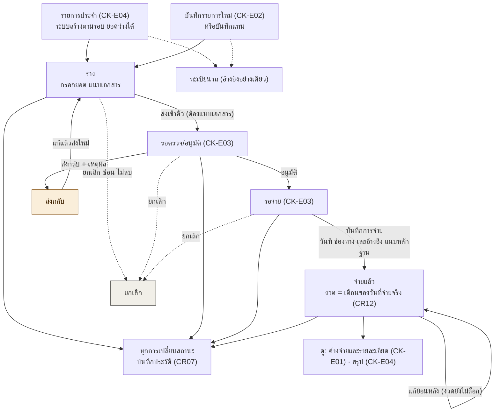
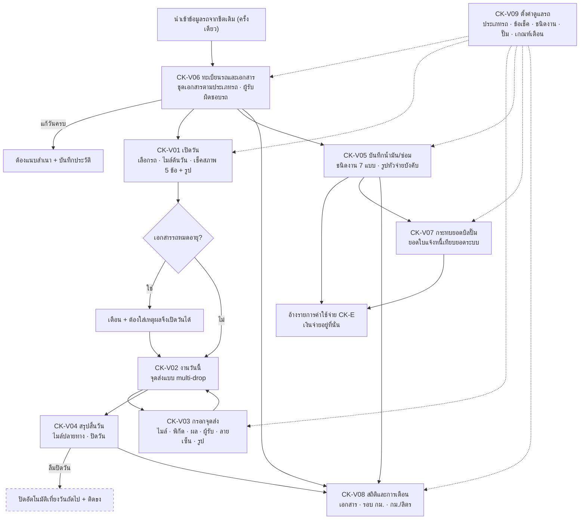

# เช็คลิส

เฟส (ข้อเสนอ v0, รอยืนยัน): 1

หน้าตามชีต "หน้าและฟังก์ชัน" ในไฟล์ Yearplan2026 Sell.xlsx (ชีตมี CK-E 6 หน้า ผู้ใช้เห็นชอบให้รวมหน้ารายละเอียดเข้ากับหน้ารายการเมื่อ 20 ต.ค. 2026 จึงเหลือ CK-E 5 หน้า และเลขเรียงใหม่ต่อเนื่อง เลขในชีตจึงไม่ตรงกับด้านล่างอีกต่อไป):

- CK-E01 รายการค้างจ่าย (รวมรายละเอียดรายการ)
- CK-E02 บันทึก/แก้รายการค่าใช้จ่าย (รวมบันทึกแทน)
- CK-E03 คิวตรวจ/อนุมัติ/จ่าย
- CK-E04 รายการประจำ
- CK-E05 สรุปค้างจ่าย
- CK-V01 เปิดวัน
- CK-V02 งานวันนี้
- CK-V03 กรอกจุดส่ง
- CK-V04 สรุปสิ้นวัน
- CK-V05 บันทึกน้ำมัน/ซ่อม
- CK-V06 ทะเบียนรถและประวัติรายคัน
- CK-V07 กระทบยอดบิลปั๊ม
- CK-V08 สถิติและการเตือน
- CK-V09 ตั้งค่าดูแลรถ

## ของเดิมที่พบ (ใช้เป็นฐานของ wireframe)

ตรวจเมื่อ 20 ต.ค. 2026 จากไฟล์และ artifact ของผู้ใช้ ข้อมูลตัวอย่างในต้นแบบ (ชื่อคน ทะเบียนรถ ยอด) เป็นข้อมูลจำลอง ไม่ใช่ข้อมูลจริง และต้นแบบเก็บข้อมูลในเบราว์เซอร์ ยังไม่มีฐานข้อมูลจริง

| ของเดิม | ที่อยู่ | ครอบคลุม |
|---|---|---|
| ระบบปฏิบัติงาน SWE (artifact, 5 ก.ย.) | claude.ai/artifact/31e883kmQShgzoD9fEjj7f | 2 โมดูลในแอปเดียว ใช้ผู้ใช้ สิทธิ์ และแผนกชุดเดียวกัน: (1) เช็คลิสต์/ตรวจสาขา (2) ดูแลรถ |
| ตรวจสาขา SWE (artifact, 3 ก.ย.) | claude.ai/artifact/H6KMYn9BsKsVRDooa32ADx | โมดูลเช็คลิสต์ตัวเดียว เป็นต้นฉบับของโมดูลแรกข้างบน |
| Expense Manager Wireframe (artifact, 15 ต.ค.) | claude.ai/artifact/W1fTHq8nQuo8gxQVweeyun | ค่าใช้จ่าย: รายการประจำ ส่งบิล ตรวจ/จ่าย รายงาน MD |
| แอปค่าใช้จ่าย Apps Script | `Design Ai/expense-app/` (Code.gs, index.html) | ระบบค่าใช้จ่ายหลายนิติบุคคลที่ใช้อยู่เดิม (Google Sheet, LINE, งบ) |

### ทะเบียนรถ: ต้นแบบเดิมครบกว่าร่างเดิม (ปรับ CK-V ตามต้นแบบแล้ว 20 ต.ค. ตารางนี้เป็นการเทียบก่อนปรับ)

| เรื่อง | ต้นแบบเดิม (ดูแลรถ) | ร่างโครง CK-V |
|---|---|---|
| ข้อมูลรถ | ทะเบียน รุ่น เจ้าของ (สาขา/ส่วนกลาง) เลขไมล์ ต่อทะเบียน/พ.ร.บ. ประกัน รอบน้ำมันเครื่องและยางเป็น กม. ผู้รับผิดชอบรายคัน | ทะเบียน ประเภท ผู้รับผิดชอบ สาขา วันครบเอกสารตามประเภทรถ |
| เตือน | น้ำมันเครื่องและยางตามระยะ กม. ทะเบียน/พ.ร.บ./ประกันตามวัน | เอกสารใกล้หมดอายุ (ยังไม่มีเตือนตามระยะ กม.) |
| งานประจำวัน | คนขับเปิดวัน (เลขไมล์ รูปพร้อมพิกัด) บันทึกเที่ยวและจุดส่ง (ผู้รับ ลายเซ็น รูป เหตุผลส่งไม่สำเร็จ) สรุปปิดวัน ปิดอัตโนมัติเที่ยงวันถัดไป | ใบงานส่งงาน (ต้นทาง ปลายทาง ผู้ขับ เลขไมล์) |
| น้ำมัน | เติมน้ำมัน เลขไมล์ ลิตร ราคา บังคับรูปหัวจ่าย คำนวณ กม./ลิตร ล่วงหน้า เทียบเฉลี่ยฝูงรถ กระทบยอดบิลปั๊มเป็นไฟล์ CSV | บันทึกน้ำมัน แนบบิล อ้างรายการค่าใช้จ่าย |
| ซ่อม | ชนิดงานซ่อม รวมเติมน้ำมัน เปลี่ยนยาง แบต ต่อทะเบียน/พ.ร.บ. อุบัติเหตุ ร้าน/อู่ ค่าใช้จ่าย รูปหลักฐาน | บันทึกซ่อม ป้ายชนิดงาน อ้างรายการค่าใช้จ่าย |
| เช็คสภาพรถก่อนออกงาน | มี 5 ข้อ (ยาง ไฟ น้ำมันเครื่อง/น้ำหล่อเย็น เบรก/พวงมาลัย รอยรั่ว) | ไม่มี |
| สถิติ | กม./ลิตรรายคัน บาท/กม. การเตือนที่ต้องจัดการ | CK-V06 เดิม (ตอนนี้คือ CK-V08 สูตรรอ Formula Gate) |
| ออฟไลน์ | บันทึกในเครื่องก่อน แล้ว sync | ไม่มี |
| สิทธิ์ | บทบาทตายตัว: คนขับ, ธุรการขนส่ง, ช่างดูแลรถ, ผู้บริหาร, ผจก.สาขา, Admin | ตารางสิทธิ์ตามตำแหน่งใน core |
| ชุดเอกสารตามประเภทรถ | ไม่มี (ใช้ฟิลด์ตายตัว ต่อทะเบียน/พ.ร.บ. กับประกัน) | มี (ตั้งค่าได้) |

### ค่าใช้จ่าย: สามแบบที่ไม่เหมือนกัน

| เรื่อง | ต้นแบบเดิม (เช็คลิสต์ใน ระบบปฏิบัติงาน SWE) | Wireframe Expense Manager | ร่าง CK-E |
|---|---|---|---|
| แนวคิด | ค่าใช้จ่ายเป็นข้อหนึ่งในเช็คลิสต์ (ชนิดคำถาม "รายการค่าใช้จ่าย") ส่งตามงวดและคิดคะแนนตามความตรงเวลา | งานที่สร้างจากรายการประจำ สาขาส่งบิล บัญชีตรวจและจ่าย | รายการเดินผ่านสถานะ ตรวจ/อนุมัติ จ่าย |
| ฟิลด์ | จำนวนเงิน เลขที่เอกสาร ครบกำหนดชำระ วันที่จ่าย สถานะจ่าย (จ่ายแล้ว/ค้างจ่าย/ยกเลิก) ไฟล์แนบ | ยอดจริง เลขที่ใบแจ้งหนี้ รูปบิล ช่องทางจ่าย เลขอ้างอิง สลิป | ผู้รับเงิน เลขที่เอกสาร จำนวน ครบกำหนด สาขา/แผนก ประเภท ทะเบียนรถ แนบเอกสาร |
| ตรวจ/อนุมัติ | ไม่มีคิวอนุมัติ มีผู้ตรวจสอบภายในและฝ่ายสุ่มตรวจให้คะแนน | บัญชีตรวจและจ่ายรวมกัน ไม่มีส่งกลับ | ตรวจ/อนุมัติ 1 ขั้น ส่งกลับพร้อมเหตุผล |
| งวด | รายวัน/สัปดาห์/เดือน/ไตรมาส/ครึ่งปี/ปี/ครั้งเดียว | รอบเป็นจำนวนเดือน | รอบเป็นจำนวนเดือน |
| เตือน | หน้า "วันนี้" แสดงงานครบกำหนดใน 3 วันและตกค้าง ไม่แจ้งเตือน | T-5 T-1 escalation Line | ไฮไลต์ใกล้ครบ (3 วัน) ไม่แจ้งเตือน |
| คะแนน | คะแนนอัตโนมัติจากความตรงเวลา | ไม่มี | ไม่มี |

### เช็คลิสต์ตรวจสาขา: ทับกับโมดูล 03 (ความพร้อมการขาย)

ต้นแบบเดิมมีตัวสร้างเช็คลิสต์ (ชนิดคำถาม 11 แบบ รูปก่อน/หลัง คะแนน 1–5 ความถี่ ชั้นความลับ การแชร์ข้อให้แผนกอื่นอ่าน) สุ่มตรวจโดยผู้จัดการเขตและผู้ตรวจสอบภายใน ซึ่งตรงกับ SL-D01 ถึง SL-D04 และ SL-S01 ถึง SL-S04 ของ `03_ระบบขาย` ต้องตัดสินว่าจะนับเป็นโมดูล 01 หรือ 03

## งานค่าใช้จ่าย (CK-E01 ถึง CK-E05): flow

สถานะ: ร่าง flow ยืนยันแล้วบางส่วน (ข้อ 1, 2, 5 ผู้ใช้ตกลงตามข้อเสนอ; ข้อ 4 ยังไม่มีสูตร)

### สถานะรายการ

รอตรวจ/อนุมัติ → รอจ่าย → จ่ายแล้ว
ส่งกลับพร้อมเหตุผล: รายการกลับไปแก้ แล้วส่งใหม่เข้าคิวรอตรวจ/อนุมัติ

### เคส

| เคส | ขั้นตอนของระบบ | การกระทำที่ต้องมีสิทธิ์ |
|---|---|---|
| A. บันทึกรายการใหม่ (CK-E02) | กรอกผู้รับเงิน เลขที่เอกสาร จำนวน วันครบกำหนด สาขา/แผนก ประเภท แนบไฟล์ แล้วส่งเข้าคิว | CK-E02: เพิ่ม |
| A2. ตรวจ/อนุมัติ (CK-E03) | อนุมัติ หรือส่งกลับพร้อมเหตุผล | CK-E03: อนุมัติ |
| A3. จ่ายและปิดรายการ (CK-E03) | บันทึกการจ่ายและแนบหลักฐาน | CK-E03: บันทึกการจ่าย |
| B. รายการประจำ (CK-E04) | ระบบสร้างรายการค้างจ่ายทุกเดือนโดยยอดว่าง กรอกยอดแล้วเข้าเคส A | CK-E04: เพิ่ม/แก้ไข และ CK-E02: แก้ไข |
| C. แก้ย้อนหลัง (CK-E02) | ทำได้เฉพาะงวดที่ยังไม่ล็อก | CK-E02: แก้ย้อนหลัง |
| D. ยกเลิก (CK-E02) | ซ่อนรายการพร้อมประวัติ ไม่ลบจริง | CK-E02: ยกเลิก |
| F. บันทึกแทนสาขา (CK-E02) | ผู้มีสิทธิ์บันทึกรายการแทนสาขาที่ไม่ส่ง ประวัติระบุว่าทำแทนใคร แล้วเข้าเคส A | CK-E02: บันทึกแทน |
| E. ปิดงวด (CR12) | ล็อกงวดรายเดือนตามวันที่จ่ายจริง ปลดล็อกต้องใส่เหตุผล | CR12: ปิดงวด/ปลดล็อก |

ใครมีสิทธิ์ทำการกระทำเหล่านี้ กำหนดที่ตารางสิทธิ์ตำแหน่งใน `00_ระบบกลาง` เท่านั้น ตำแหน่งเดียวทำได้หลายขั้น flow นี้ไม่ระบุบทบาท

### กฎที่ใช้

- ผู้บันทึกต้องไม่เป็นผู้อนุมัติรายการของตัวเอง
- ขั้นตรวจ/อนุมัติมี 1 ขั้น
- สำเร็จ = จ่ายแล้วพร้อมหลักฐาน; ไม่สำเร็จ = ถูกส่งกลับหรือยกเลิก
- ใช้ "ใกล้ครบกำหนด" เมื่อเหลือไม่เกิน 3 วันก่อนวันครบกำหนด (ไฮไลต์ในหน้า ไม่ส่งแจ้งเตือน)
- รายการประจำมีรอบเป็นจำนวนเดือน (1, 3, 12 ฯลฯ) ยอดว่างไม่นับในยอดรวม
- เลขที่เอกสาร ERP ไม่บังคับก่อนจ่าย

### ยังไม่ตัดสิน (Formula Gate)

- สูตรอายุหนี้ ([สูตร TBD] ใน CK-E05): ยังไม่มีข้อเสนอที่อนุมัติ ห้ามลงโค้ดจนกว่าจะผ่าน Formula Gate

## เปรียบเทียบฟังก์ชันค่าใช้จ่ายสามแบบ และข้อเสนอ

ผู้ใช้ขอให้เทียบฟังก์ชันของสามแบบและเสนอพร้อมเหตุผล (20 ต.ค. 2026) ข้อมูลมาจากการเปิดดูหน้าจอจริงทีละหน้า (แบบ 3 ใช้ข้อมูลจำลอง) และการถอดโค้ด ป้าย "ข้อเสนอ" รอผู้ใช้ยืนยัน

- แบบ 1 = ต้นแบบเช็คลิสต์ (ระบบปฏิบัติงาน SWE) ค่าใช้จ่ายเป็นชนิดคำถามหนึ่งในเช็คลิสต์
- แบบ 2 = Expense Manager Wireframe
- แบบ 3 = แอป Apps Script เดิม (ต่อ Google Sheet)

ข้อสังเกตแรก: สามแบบทำคนละงาน แบบ 1 และ 2 ติดตามการส่งบิลและการจ่าย (ก่อนลงบัญชี) ส่วนแบบ 3 วิเคราะห์ค่าใช้จ่ายที่เกิดขึ้นแล้วจากชีต (หลังลงบัญชี) จึงไม่ใช่ตัวเลือกแทนกัน แต่ต้องตัดสินว่าจะรับแต่ละฟังก์ชันไว้ตรงไหน

| ฟังก์ชัน | แบบ 1 ต้นแบบเช็คลิสต์ | แบบ 2 Wireframe | แบบ 3 แอปเดิม | ข้อเสนอ | เหตุผล |
|---|---|---|---|---|---|
| ตั้งรายการประจำ | ความถี่ 7 แบบ (รายวัน ถึง ปี, ครั้งเดียว) วันที่ส่ง ไม่สร้างงวดก่อนวันนี้ | Template: หมวด ชื่อ สาขา แผนก ผู้ให้บริการ ยอดประมาณ วันเริ่ม ทุกกี่เดือน ชำระวันที่ จำนวนงวด เตือนงวดสุดท้าย พรีวิว 6 งวด | ฟอร์ม 14 ช่อง (รหัสเจ้าหนี้ รหัสในระบบ กลุ่มเอกสาร ฯลฯ) รายการพร้อมแถบความคืบหน้า | ใช้ฟิลด์ของแบบ 2 เป็นฐาน เพิ่ม "รหัสเจ้าหนี้" และ "รหัสในระบบ" จากแบบ 3 | ค่าใช้จ่ายรอบเป็นเดือนพอ (ค่าเช่า ค่าไฟ ประกัน 12 เดือน) ความถี่รายวัน/สัปดาห์ของแบบ 1 ไม่จำเป็น พรีวิวงวดกันตั้งรอบผิด รหัส ERP ช่วยกระทบกับบัญชี |
| ทะเบียนเจ้าหนี้ | ไม่มี | เลือกผู้ให้บริการในฟอร์ม | หน้าทะเบียนเจ้าหนี้: ค้นหา สถานะ แถบความคืบหน้า ยกเลิกหลายรายการ ส่งออก CSV | ใช้ข้อมูลหลักผู้ขาย/เจ้าหนี้ของ core (CR09) แทนหน้าแยก และเก็บ "ยกเลิกหลายรายการ" กับ "ส่งออก CSV" ไว้ในรายการประจำ (CK-E04) | เจ้าหนี้ต้องเป็นชุดเดียวทุกระบบ (ตกลงแล้วว่าใช้ทะเบียนเจ้าหนี้กลาง) |
| บันทึก/ส่งบิล | จำนวนเงิน เลขที่เอกสาร ครบกำหนด วันจ่าย สถานะจ่าย แนบ ส่งแล้วแก้ไม่ได้ | ยอดจริง เลขที่ใบแจ้งหนี้ รูปบิล (บังคับ) หมายเหตุ | ไม่มี (อ่านจากชีต) | ใช้ CK-E02 ที่ร่างไว้ และเก็บกฎ "ส่งแล้วล็อก แก้ได้เฉพาะเมื่อถูกส่งกลับ" ของแบบ 1 | ล็อกหลังส่งกันแก้ตัวเลขหลังตรวจ ส่วนการส่งกลับเป็นช่องทางแก้ที่มีร่องรอย |
| ตรวจ/อนุมัติ | ไม่มีคิว มีผู้ตรวจสอบภายในสุ่มให้คะแนน | บัญชีตรวจและจ่ายรวมกัน ไม่มีส่งกลับ | ไม่มี | ใช้ CK-E03 (ตรวจ/อนุมัติ 1 ขั้น ส่งกลับพร้อมเหตุผล) | เป็นแบบเดียวที่ควบคุมเงินก่อนจ่ายได้ ใครทำขั้นไหนได้ตั้งที่ตารางสิทธิ์ |
| บันทึกการจ่าย | วันจ่าย สถานะจ่าย | วันที่จ่ายจริง ช่องทาง เลขอ้างอิง/เลขเช็ค สลิป | ไม่มี | ใช้ฟอร์มของแบบ 2 (ตามที่ร่างไว้แล้ว) | ครบพอสำหรับตรวจกับสเตทเมนต์ และกำหนดงวดจากวันจ่ายจริง |
| บันทึกแทนสาขา | ไม่มี | บัญชี "บันทึกเอง" แทนสาขาที่ไม่ส่ง | ไม่มี | รับจากแบบ 2 (ร่างไว้แล้ว) | งานไม่ค้างเมื่อสาขาไม่ส่ง และประวัติระบุว่าทำแทนใคร |
| ติดตามที่ยังไม่ส่ง/เลยกำหนด | หน้า "วันนี้": ครบกำหนดใน 3 วันและตกค้าง | D4: ตารางสาขา วันที่เลย ติดตามล่าสุด ส่ง Line/บันทึกเอง | แผง "ใกล้หมดสัญญา" และ "แจ้งเตือน LINE" | ทำเป็นตัวกรองใน CK-E01 (ร่างที่ยอดว่างและเลยกำหนด) บวกตัวเลขงานค้างบนหน้าหลัก (CR02) ไม่ทำหน้าใหม่ | เฟสแรกไม่มีแจ้งเตือน หน้าเดียวที่เปิดดูเองพอ ส่วนปุ่มส่ง Line เลื่อนเป็นเฟสถัดไป |
| ปฏิทิน | ไม่มี | C1 ปฏิทินสาขา | ปฏิทินพร้อมสรุปค่าเช่า ค่าไฟ+น้ำ | เพิ่มมุมมองปฏิทินใน CK-E01 (สลับรายการ/ปฏิทิน) เป็นเฟสถัดไป | สองแบบมีตรงกัน แสดงว่าใช้จริง ต้นทุนต่ำเพราะใช้ข้อมูลชุดเดียวกัน แต่ไม่จำเป็นต่อการควบคุมเงิน |
| รายงานภาพรวม | คะแนนความตรงเวลา | E1 สรุปรายเดือนแยกสาขา Top 5 | วิเคราะห์: รวมยอด แยกหมวด Top 3 ต่อนิติบุคคล แนวโน้ม 12 เดือน สัดส่วน | เฟสแรกใช้ CK-E05 (ยอดค้างตามสาขาและประเภท) เฟสถัดไปเพิ่มแนวโน้มและสัดส่วนหลังผ่าน Formula Gate | สัดส่วนและแนวโน้มเป็นสูตร ต้องอนุมัติก่อน และแบบ 3 อ่านข้อมูลที่ลงบัญชีแล้ว ซึ่งต่างจากสิ่งที่ระบบใหม่เก็บ |
| งบ เทียบจริง | ไม่มี | เป้า เทียบงบ ส่วนต่าง | ตารางงบรายหมวด สถานะเขียว/เหลือง/แดง บันทึกงบ ส่งอีเมล MD | เลื่อนเป็นเฟสหลัง ขึ้นอยู่กับว่าใครเป็นเจ้าของงบและงบอยู่ที่ไหน | เป็นสูตรทั้งหมด (ส่วนต่าง สัดส่วน เกณฑ์สี) และข้อมูลงบยังไม่รู้ที่เก็บ จึงต้องถามผู้ใช้ก่อน |
| แยกนิติบุคคล (SWT SWE WMN WPS) | ไม่มี | ไม่มี (ใช้ชื่อสาขา) | มี ทุกหน้า | ตามกรอบที่ตัดนิติบุคคลออกจากฟอร์ม แต่เก็บเป็นข้อมูลหลัก (CR10) ให้รายงานแยกได้ | กลุ่มมี 4 นิติบุคคลจริง ถ้ารายงานต้องแยกก็แยกได้โดยไม่ต้องกรอกในทุกรายการ ต้องยืนยันกับผู้ใช้ |
| คะแนนความตรงเวลา | คะแนนอัตโนมัติจากวันครบกับวันจ่าย | ไม่มี | ไม่มี | ไม่รับเข้า CK-E | เป็น KPI ผูกการประเมินคน เป็นเขตแดงและเป็นสูตร ควรแยกไปโมดูลเช็คลิสต์ตรวจสาขา/KPI |
| แจ้งเตือน | ไม่มีระบบแจ้งเตือน | T-5 T-1 escalation Line Weekly Digest | แจ้งเตือน LINE ครบกำหนด และงบเกินทางอีเมล มีตัวตั้งเวลารายวัน | เฟสถัดไป ใช้โค้ดส่ง LINE Messaging ของแบบ 3 เป็นฐาน | กรอบเฟส 1 ไม่มีแจ้งเตือน โค้ดของแบบ 3 ระบุว่า LINE Notify เดิมเลิกให้บริการแล้ว (31 มี.ค. 2025) ต้องใช้ Messaging API |
| ประวัติการแก้ไข | ไม่ชัดเจน | ไม่มี | AuditLog (ก่อน/หลัง ผู้ทำ) | ใช้ประวัติของ core (CR07) | เก็บค่าก่อน-หลังแล้ว ไม่ต้องทำซ้ำในโมดูล |
| สิทธิ์และความลับ | ชั้นความลับ 3 ระดับ แชร์ข้อให้แผนกอื่นอ่าน | Role Matrix ร่าง 4 บทบาท | บทบาท md/สาขาจากอีเมลโดเมน และชีตผู้ใช้ | ใช้ตารางสิทธิ์ตำแหน่ง (CR05) และกลุ่มเอกสาร (CR06) ที่เดียว | ผู้ใช้สั่งให้สิทธิ์ทุกส่วนอยู่ที่โมดูลกลาง |
| ข้อมูลตั้งต้น | กรอกในเช็คลิสต์ | นำเข้ารายการประจำจากชีต 2 เดิมได้ | อ่านจากชีต Transaction และ Recurring | เริ่มใหม่ ไม่ย้ายข้อมูล ตามที่ตกลงไว้ | ให้รายการประจำสะอาดตั้งแต่เริ่ม ถ้าต้องการนำเข้า ให้ตัดสินใจใหม่ |

### สิ่งที่รับเข้า CK-E จากแต่ละแบบ

| จากแบบ | รับเข้า |
|---|---|
| แบบ 1 | ส่งแล้วล็อก แก้ได้เมื่อถูกส่งกลับ · มุมมอง "ครบกำหนดใน 3 วันและตกค้าง" (เป็นตัวกรองและตัวเลขงานค้าง) |
| แบบ 2 | ฟิลด์ Template และพรีวิวงวด · ฟอร์มบันทึกการจ่าย · บันทึกแทน · ติดตามที่ยังไม่ส่ง · ปฏิทิน (เฟสถัดไป) |
| แบบ 3 | รหัสเจ้าหนี้และรหัสในระบบ · ยกเลิกหลายรายการและส่งออก CSV ในรายการประจำ · แนวคิดวิเคราะห์และงบ (เฟสหลัง) · โค้ดส่ง LINE (เฟสถัดไป) |

### ชื่อ "กลุ่มเอกสาร" ซ้ำกัน

แบบ 3 มีฟิลด์ "กลุ่มเอกสาร" ในรายการประจำ (กลุ่มของเอกสารบัญชี เช่น AP) ซึ่งคนละเรื่องกับ "กลุ่มเอกสาร" ของ core (กลุ่มที่กำหนดว่าตำแหน่งไหนเห็นเอกสาร) ควรตั้งชื่อให้ต่างกัน เช่น "ชนิดเอกสารบัญชี" สำหรับฟิลด์ของรายการประจำ

## ค่าใช้จ่าย: ร่างรายละเอียดหน้า (CK-E01 ถึง CK-E05)

โมดูลนี้ทำอะไร: ติดตามค่าใช้จ่ายที่ต้องจ่าย ตั้งแต่บันทึกรายการ ตรวจหรืออนุมัติ จนบันทึกการจ่าย แทนระบบ Apps Script เดิม ระบบนี้บันทึกสถานะอย่างเดียว ไม่โอนเงินและไม่ลงบัญชี (การลงบัญชีละเอียดอยู่ที่ ERP)

ร่างโครงให้ผู้ใช้แก้ทีหลัง ฟิลด์ผสมระหว่างที่ตกลงไว้กับ Expense Manager Wireframe ป้าย "ข้อเสนอ" คือค่าที่ผมเสนอเอง สิทธิ์ทุกปุ่มตั้งที่ตารางสิทธิ์ตำแหน่ง (`00_ระบบกลาง`) ทุกรายการมีคอลัมน์คำอธิบาย

### flow ของค่าใช้จ่าย

แสดงเป็นแผนภาพได้ใน GitHub และ Obsidian (เขียนด้วย Mermaid) สีส้ม = ส่งกลับ สีเทา = ยกเลิก

### สถานะของรายการ

| สถานะ | ความหมาย | คำอธิบาย |
|---|---|---|
| ร่าง | กรอกอยู่ ยังไม่ส่งเข้าคิว | แก้ได้อิสระ ไม่มีใครเห็นในคิวตรวจ |
| รอตรวจ/อนุมัติ | อยู่ในคิวรอตรวจหรืออนุมัติ | ผู้มีสิทธิ์ตรวจเห็นและตัดสินใจได้ มีขั้นเดียวตามที่ตกลง |
| ส่งกลับ | ตรวจแล้วไม่ผ่าน กลับไปแก้ | ต้องมีเหตุผลเสมอ แก้แล้วส่งใหม่ |
| รอจ่าย | อนุมัติแล้ว รอบันทึกการจ่าย | แยกจากขั้นตรวจเพื่อให้เห็นว่าอะไรอนุมัติแล้วแต่ยังไม่จ่าย |
| จ่ายแล้ว | บันทึกการจ่ายและแนบหลักฐานแล้ว | ปิดรายการ งวดนับจากเดือนของวันที่จ่ายจริง |
| ยกเลิก | ซ่อนรายการ ไม่ลบจริง | ประวัติยังอยู่ครบตามกฎ "ลบ = ยกเลิก/ซ่อน" |
| ไฮไลต์ใกล้ครบกำหนด / เกินกำหนด | ป้ายในหน้า ไม่ใช่สถานะ | เฟสแรกไม่มีระบบแจ้งเตือน ผู้ใช้เห็นจากไฮไลต์เมื่อเปิดหน้า ใกล้ครบ = เหลือไม่เกิน 3 วัน |

### CK-E01 รายการค้างจ่าย (ดูรายการและรายละเอียด ไม่แก้ข้อมูล)

หน้านี้ทำอะไร: ดูรายการค้างจ่ายทั้งหมดที่ผู้ดูมีสิทธิ์เห็น เรียงตามวันครบกำหนด และกดแถวเพื่อดูรายละเอียดและประวัติของรายการนั้นในหน้าเดียวกัน (รวมหน้ารายละเอียดเดิมเข้ามา 20 ต.ค. 2026)

| ส่วน | รายการ | สถานะ | คำอธิบาย |
|---|---|---|---|
| แถบตัวเลขบนหัว | 3 ช่อง: รอส่ง/ยอดว่าง, เกินกำหนด, รอจ่าย | ตกลงแล้ว (ปรับตามข้อเสนอ 20 ต.ค.) | เห็นภาพรวมก่อนไล่ทีละแถว Wireframe ทั้ง B1 และ D1 มี ส่วนตัวเลขรวมของทั้งระบบอยู่ที่ CR02 |
| ตัวกรอง | สถานะ, สาขา/แผนก, ประเภท, ช่วงครบกำหนด | ตกลงแล้ว | หาเฉพาะรายการที่สนใจ (ชีตระบุนิติบุคคลด้วย แต่กรอบตัดนิติบุคคลแล้ว จึงใช้สาขา/แผนกแทน) |
| ตัวกรองเร็ว | "ยอดว่าง" และ "เลยกำหนด" | ตกลงแล้ว (ปรับตามข้อเสนอ) | แทนหน้า "ติดตามที่ยังไม่ส่ง" (D4) ของ Wireframe ไม่ต้องสร้างหน้าใหม่ |
| แถว | เรียงตามวันครบกำหนด | ตกลงแล้ว | งานที่ใกล้ครบกำหนดอยู่บนสุด |
| แถว | บอกต้นทางของรายการ: จากรายการประจำ / บันทึกเอง / บันทึกแทน | ต้นทางต่อแถวเป็นข้อเสนอ | ทุกแถวบอกว่ามาจากไหน ตามหลักที่ตกลงไว้ |
| ไฮไลต์ | ใกล้ครบกำหนด (เหลือไม่เกิน 3 วัน) และเกินกำหนด พร้อมจำนวนวันที่เลย ไม่ส่งแจ้งเตือน | ตกลงแล้ว (จำนวนวันที่เลยเพิ่มตามข้อเสนอ) | เฟสแรกไม่มีแจ้งเตือน ไฮไลต์เป็นทางเดียวที่ผู้ใช้เห็น จำนวนวันที่เลยให้ข้อมูลเดียวกับ D4 |
| งานค้างให้ CR02 | รายการที่ผู้ดูมีสิทธิ์ตรวจหรือจ่ายและอยู่ในสถานะรอ | ข้อเสนอ | ทำให้ตัวเลขงานค้างบนหน้าหลักตรงกับสิทธิ์จริง |
| แผงรายละเอียด (กดแถว) | ไทม์ไลน์: สถานะ ใครทำ เมื่อไร เหตุผลที่ส่งกลับ | ตามชีต | เห็นว่ารายการนี้เดินมาอย่างไร ติดที่ไหน แทนหน้ารายละเอียดเดิม |
| แผงรายละเอียด | หลักฐานรวมที่เดียว: เอกสารของรายการ และหลักฐานการจ่าย ดูและแนบได้ | ตามชีต | ไม่กระจายสองหน้าอย่างใน Wireframe (รูปบิลที่ B2 สลิปที่ D3) |
| แผงรายละเอียด | ลิงก์ไปรายการประจำต้นทางและทะเบียนรถ (ถ้ามี) | ข้อเสนอ | ตามหลักบอกต้นทางของทุกรายการ |
| สิทธิ์ดูประวัติ | ไทม์ไลน์/ประวัติในแผงรายละเอียดต้องใช้สิทธิ์ "ดูประวัติ" แยกจากสิทธิ์ดูรายการ | ข้อเสนอ | ตามที่ตกลงว่า "ดูประวัติ" เป็นสิทธิ์เขตแดงใน CR05 รวมหน้ากันแล้วสิทธิ์ต้องไม่ติดมาด้วย |
| ปุ่ม | ดู, ส่งออก | ตามชีต | หน้านี้ไม่แก้ข้อมูล การแก้ทำที่ CK-E02 |
| มุมมองปฏิทิน | สลับ รายการ/ปฏิทิน | เฟสถัดไป | สองแบบเดิมมีตรงกัน ใช้ข้อมูลชุดเดียวกัน แต่ไม่จำเป็นต่อการควบคุมเงิน |

### CK-E02 บันทึก/แก้รายการค่าใช้จ่าย (รวมบันทึกแทน)

หน้านี้ทำอะไร: สร้างรายการค่าใช้จ่ายใหม่ แก้ไข แก้ย้อนหลัง ยกเลิก หรือบันทึกแทนสาขาที่ไม่ส่ง (เขตแดง เกี่ยวกับเงิน)

| ส่วน | รายการ | สถานะ | คำอธิบาย |
|---|---|---|---|
| ฟิลด์ | ผู้รับเงิน (เลือกจากทะเบียนเจ้าหนี้กลาง) | ตกลงแล้ว | ใช้เจ้าหนี้ชุดเดียวทั้งระบบ ไม่พิมพ์ชื่อเอง ชื่อจะได้ไม่เพี้ยน |
| ฟิลด์ | เลขที่เอกสาร | ตกลงแล้ว | อ้างถึงใบแจ้งหนี้หรือบิลของผู้รับเงิน |
| ฟิลด์ | จำนวนเงิน พร้อมป้าย "ประมาณ" หรือ "จริง" | จำนวนเงินตกลงแล้ว ป้ายเป็นข้อเสนอที่ผู้ใช้รับแล้ว | หนึ่งรายการจ่ายครั้งเดียว ไม่แยก VAT หรือภาษี (ละเอียดอยู่ที่ ERP) ป้ายช่วยให้เห็นว่ารายการที่มาจากรายการประจำยังไม่ได้กรอกยอดจริง |
| ฟิลด์ | วันครบกำหนด | ตกลงแล้ว | ใช้เรียงและไฮไลต์ |
| ฟิลด์ | สาขา/แผนก (1 ค่า) | ตกลงแล้ว | ตัดนิติบุคคลตามกรอบ เก็บแค่ที่ใช้ตามงานจริง |
| ฟิลด์ | ประเภท (ของระบบเอง) | ตกลงแล้ว | จัดกลุ่มค่าใช้จ่ายโดยไม่ผูกกับผังบัญชี |
| ฟิลด์ | ทะเบียนรถ (เสริม) | ตกลงแล้ว | ผูกค่าน้ำมันหรือซ่อมกับรถ ใช้เป็นข้อมูลต้นทุนรถ |
| ฟิลด์ | หมายเหตุ | ข้อเสนอ | ใส่ข้อมูลเพิ่มเติมที่ไม่มีช่องเฉพาะ |
| แนบไฟล์ | ต้องแนบเอกสารจึงส่งเข้าคิวได้ | ข้อเสนอ ผู้ใช้รับแล้ว | ตามหลักบังคับแนบเฉพาะจุดที่เกี่ยวกับเงิน ผู้ตรวจจะได้มีของให้ตรวจ |
| เลขที่รายการ | รันอัตโนมัติ รูปแบบยังไม่กำหนด | ข้อเสนอ | ตรงกับที่ Wireframe ยังรอตกลงเรื่องรูปแบบเลข |
| การล็อก | ส่งเข้าคิวแล้วแก้ไม่ได้ แก้ได้เฉพาะเมื่อถูกส่งกลับ | ข้อเสนอ ผู้ใช้รับแล้ว | กันแก้ตัวเลขหลังตรวจ (กฎจากต้นแบบเช็คลิสต์) |
| บันทึกแทน | ผู้มีสิทธิ์บันทึกรายการแทนสาขาที่ไม่ส่ง ประวัติระบุว่าทำแทนใคร | ย้ายมาจากหน้าคิว (เดิม E04) ตามข้อเสนอ 20 ต.ค. | บันทึกแทนคือการสร้างรายการ ไม่ใช่การตรวจหรือจ่าย แยกเป็นปุ่มที่มีสิทธิ์ของตัวเองได้ชัด |
| ปุ่ม | บันทึกร่าง, ส่งเข้าคิว | บันทึกร่างเป็นข้อเสนอ | ร่างให้กรอกต่อทีหลังได้ ส่งเข้าคิวเมื่อพร้อมให้ตรวจ |
| ปุ่ม | แก้ไข, แก้ย้อนหลัง, ยกเลิก, แนบไฟล์, บันทึกแทน | ตามชีต (บันทึกแทนเป็นข้อเสนอ) | แก้ย้อนหลังทำได้เฉพาะงวดที่ยังไม่ล็อก ยกเลิกคือซ่อน ไม่ลบ |

### CK-E03 คิวตรวจ/อนุมัติ/จ่าย

หน้านี้ทำอะไร: ที่ที่รายการเดินไปข้างหน้า คือตรวจหรืออนุมัติ ส่งกลับ และบันทึกการจ่าย (เขตแดง) ตรงนี้เป็นขั้นตรวจ/อนุมัติและส่งกลับที่ไม่มีในแบบเดิม ผู้ใช้เห็นชอบให้คงไว้

| ส่วน | รายการ | สถานะ | คำอธิบาย |
|---|---|---|---|
| คิว | รอตรวจ/อนุมัติ · รอจ่าย · จ่ายแล้ว (ล่าสุด) | สถานะตกลงแล้ว การแบ่งแท็บเป็นข้อเสนอ | แยกงานที่ต้องทำออกจากงานที่เสร็จแล้ว ทุกแถวบอกต้นทาง |
| ปุ่มต่อแถว | อนุมัติ | ตกลงแล้ว | ผ่านการตรวจ ส่งต่อไปรอจ่าย |
| ปุ่มต่อแถว | ส่งกลับ (ต้องใส่เหตุผล) | ตกลงแล้ว | ให้คนบันทึกรู้ว่าต้องแก้อะไร และเหตุผลเก็บเป็นประวัติ |
| ปุ่มต่อแถว | บันทึกการจ่าย | ตกลงแล้ว | ปิดรายการ ระบบบันทึกสถานะอย่างเดียว ไม่โอนเงิน |
| ฟอร์มจ่าย | วันที่จ่ายจริง | ตกลงแล้ว | ใช้กำหนดงวด (เดือนของวันที่จ่ายจริง) |
| ฟอร์มจ่าย | ช่องทาง (โอน/เช็ค/เงินสด) และเลขอ้างอิงหรือเลขเช็ค | ข้อเสนอ จาก Wireframe | ตรวจกับสเตทเมนต์หรือเช็คได้ภายหลัง |
| ฟอร์มจ่าย | เลขที่เอกสาร ERP และรหัสในระบบ/รหัสเจ้าหนี้ (ไม่บังคับ) | ข้อเสนอ ผู้ใช้รับแล้ว | ผูกกับเอกสารที่ลงบัญชีใน ERP เมื่อมี โดยไม่บังคับให้กรอกทุกครั้ง |
| ฟอร์มจ่าย | แนบหลักฐานการจ่าย (บังคับ) | ข้อเสนอ | ตามหลักบังคับแนบเฉพาะจุดเงิน |
| จ่ายหลายรายการพร้อมกัน | ยังไม่ใส่ | เฟสหลัง | ไม่มีในแบบเดิมใดเลย ควรเห็นปริมาณงานจริงก่อน |

### CK-E04 รายการประจำ

หน้านี้ทำอะไร: ตั้งรายการที่เกิดซ้ำตามรอบ ให้ระบบสร้างรายการค้างจ่ายล่วงหน้าเอง

| ส่วน | รายการ | สถานะ | คำอธิบาย |
|---|---|---|---|
| ฟิลด์ | ประเภท, รายละเอียด, สาขา/แผนก, ผู้รับเงิน | ข้อเสนอ จาก Wireframe | ข้อมูลเดียวกับรายการค่าใช้จ่ายทั่วไป ใช้ซ้ำทุกรอบ |
| ฟิลด์ | รหัสเจ้าหนี้ และรหัสในระบบ (ไม่บังคับ) | ข้อเสนอ ผู้ใช้รับแล้ว (จากแอป Apps Script เดิม) | ช่วยกระทบกับ ERP |
| ฟิลด์ | ชนิดเอกสารบัญชี (เช่น AP) | ข้อเสนอ รอยืนยันชื่อ | แอปเดิมเรียก "กลุ่มเอกสาร" ซึ่งซ้ำกับ "กลุ่มเอกสาร" ของ CR06 จึงเสนอเปลี่ยนชื่อ |
| ฟิลด์ | ยอดประมาณ (เว้นว่างได้ ไม่นับในยอดรวม) | ตกลงแล้ว | รายการที่ยอดไม่คงที่ เช่น ค่าไฟ สร้างล่วงหน้าโดยไม่ต้องรู้ยอด |
| ฟิลด์ | วันที่เริ่ม, ทุกกี่เดือน, ชำระวันที่ | ข้อเสนอ จาก Wireframe | กำหนดรอบ เช่น ประกันภัยทุก 12 เดือน ค่าเช่าทุกเดือน |
| ฟิลด์ | จำนวนงวด (ไม่จำกัดหรือระบุ) และเตือนกี่งวดสุดท้าย | ข้อเสนอ จาก Wireframe | รายการที่มีวันสิ้นสุดแสดงสถานะใกล้สิ้นสุด |
| การสร้างรายการ | ระบบสร้างรายการค้างจ่ายล่วงหน้าตามรอบ ยอดว่างให้กรอกก่อนส่งเข้าคิว | ตกลงแล้ว | ไม่ต้องคีย์รายการประจำใหม่ทุกเดือน |
| สถานะของรายการประจำ | ใช้งาน · ใกล้สิ้นสุด · สิ้นสุด · ปิด | ข้อเสนอ | ปิดชั่วคราวได้โดยไม่ลบ |
| พรีวิว | แสดงงวดที่จะสร้าง 6 งวดแรกก่อนบันทึก | ข้อเสนอ จาก Wireframe | ตรวจว่ารอบที่ตั้งถูกต้องก่อนใช้จริง |
| ปุ่ม | เพิ่ม, แก้ไข, เปิด/ปิด, ยกเลิก | ตามชีต | ยกเลิกคือซ่อน ไม่ลบ |
| ปุ่ม | ยกเลิกหลายรายการ, ส่งออก CSV | ข้อเสนอ ผู้ใช้รับแล้ว (จากแอป Apps Script เดิม) | เลิกรายการประจำหลายตัวพร้อมกันเมื่อสัญญาสิ้นสุด และส่งออกตรวจกับบัญชีได้ ยกเลิกคือซ่อน ไม่ลบ |

### CK-E05 สรุปค้างจ่าย (ดูอย่างเดียว)

หน้านี้ทำอะไร: สรุปยอดค้างจ่ายให้เห็นภาพรวมของผู้ที่มีสิทธิ์ดู เฟสแรกมีเฉพาะการรวมยอดอย่างเดียว

| ส่วน | รายการ | สถานะ | คำอธิบาย |
|---|---|---|---|
| สรุป | ยอดค้างรวมตามสาขา/แผนกและประเภท | ตามชีต | เห็นว่าเงินค้างอยู่ที่ไหน |
| สรุป | ยอดค้างเกินกำหนด (รวมยอดของรายการที่เลยวันครบกำหนดและยังไม่จ่าย) | ข้อเสนอ ผู้ใช้รับแล้ว | เป็นการรวมยอดอย่างเดียว ไม่มีสูตรใหม่ |
| ยังไม่ใส่ | อันดับ Top N, แนวโน้ม 12 เดือน, สัดส่วน, เทียบงบ, ช่วงอายุหนี้ | เฟสหลัง รอ Formula Gate | เป็นสูตรทั้งหมด ต้องได้รับอนุมัติก่อนลงโค้ด และงบยังไม่รู้เจ้าของและที่เก็บ |
| ปุ่ม | ส่งออก | ตามชีต | ส่งต่อให้ผู้เกี่ยวข้องในรูปไฟล์ |

### ที่ปรับจากที่บันทึกไว้ก่อนหน้า

การปรับหลังเปรียบเทียบกับแบบเดิม (ผู้ใช้เห็นชอบตามข้อเสนอ 20 ต.ค. 2026): รวมหน้ารายละเอียดเข้ากับ CK-E01 · ย้ายบันทึกแทนไป CK-E02 · เพิ่มแถบตัวเลขและจำนวนวันที่เลยใน CK-E01 · เพิ่มป้าย ประมาณ/จริง และกฎล็อกหลังส่งใน CK-E02 · เพิ่มรหัสเอกสาร ERP/รหัสเจ้าหนี้ในฟอร์มจ่าย · เพิ่ม ยกเลิกหลายรายการ ส่งออก CSV และชนิดเอกสารบัญชีใน CK-E04 · CK-E05 เหลือการรวมยอดและยอดค้างเกินกำหนด · เลขหน้าเรียงใหม่ E01 ถึง E05

รอบรายการประจำ: ก่อนหน้านี้เขียนว่า "รายการประจำรายเดือนเท่านั้นในเฟสนี้" แต่ Wireframe มีรายการรอบ 12 เดือน (ประกันภัย) จึงเปลี่ยนเป็น "รอบเป็นจำนวนเดือน (1, 3, 12 ฯลฯ)" ถ้าไม่เห็นด้วยบอกได้

## ผลเทียบกับ Expense Manager Wireframe (artifact, อัปเดต 15 ต.ค.)

### ตัดสินแล้ว

- แจ้งเตือน (T-5, T-1, escalation), ส่ง Line, Weekly Digest เลื่อนไปเฟสถัดไป เฟส 1 ใช้ไฮไลต์ในหน้า (ผู้ใช้ยืนยัน)
- ใครตรวจ จ่าย หรือบันทึกแทนได้ = ตั้งที่ตารางสิทธิ์ตำแหน่งใน `00_ระบบกลาง` ระบบทำแค่เปิด/ปิดสิทธิ์ ไม่บังคับแยกคน (ผู้ใช้สั่ง)
- Role ของ Wireframe (สาขา, แผนก HQ, บัญชี, MD/GM) แทนด้วยตำแหน่ง + ขอบเขตข้อมูล (สาขาที่ผูก) ใน core
- ถ่ายรูปบิลจากมือถือ (B2) รอเฟสมือถือ ตามกรอบ "คอมพิวเตอร์ก่อน"
- รายการที่เกี่ยวกับเงินต้องแนบหลักฐาน แทนตัวเลือก "ต้องแนบรูปบิล" ต่อ Template (ตามหลักบังคับแนบเฉพาะจุดเงินและวันหมดอายุ)

### รับจาก Wireframe เข้า flow (รอยืนยันตอนลงรายละเอียดหน้า)

- E04 ฟอร์มบันทึกการจ่าย: วันที่จ่ายจริง, ช่องทางจ่าย (โอน/เช็ค/เงินสด), เลขอ้างอิงหรือเลขเช็ค, แนบหลักฐาน
- เคส "บันทึกแทน": ผู้มีสิทธิ์บันทึกแทนสาขาที่ไม่ส่ง และบันทึกประวัติว่าทำแทนใคร
- E05 ฟิลด์ Template: ทุกกี่เดือน, ชำระวันที่, จำนวนงวด, ผู้ส่งบิล, พรีวิวงวด, สถานะใกล้สิ้นสุด

### พักไว้

- ปฏิทิน (C1) ไม่อยู่ในรายการหน้าเดิม
- รายงานเทียบงบ ส่วนต่าง % ของทั้งหมด Top 5 ต้องผ่าน Formula Gate และยังไม่มีแหล่งข้อมูลงบ
- ค่าใช้จ่ายครั้งเดียว (ไม่ใช่รายการประจำ): Wireframe ไม่มี แต่ E02 รองรับ ยืนยันตอนลงรายละเอียด

### ต้องแก้ใน Wireframe (ยังไม่ได้แก้)

- ชื่อ "วินมันนี่" เป็น "วีมันนี่ (VMN)"
- "₿" เป็น "฿"
- ปี 2567 กับ 2569 ให้สอดคล้องกัน

## ดูแลรถ (CK-V01 ถึง CK-V09): ปรับตามต้นแบบเดิม

ผู้ใช้ตัดสินใจ (20 ต.ค. 2026) ให้ใช้ต้นแบบ "ดูแลรถ" ใน artifact ระบบปฏิบัติงาน SWE เป็นฐานของทะเบียนรถ หน้า 1 ถึง 8 ของต้นแบบ = CK-V01 ถึง CK-V08 ตามลำดับ และเติมชุดเอกสารตามประเภทรถ

ถอดจากโค้ดและการเปิดดูหน้าจอ ไม่ได้ทดสอบทุกกรณี ข้อมูลตัวอย่างในต้นแบบ (ทะเบียน ชื่อคน ยอด) เป็นข้อมูลจำลอง สิทธิ์ทุกปุ่มตั้งที่ตารางสิทธิ์ตำแหน่ง (`00_ระบบกลาง`) ป้าย "ข้อเสนอ" คือค่าที่ผมเสนอเอง ทุกรายการมีคอลัมน์คำอธิบาย

### เลขหน้าเปลี่ยนจากร่างเดิม

| ร่างเดิม | ใหม่ | คำอธิบาย |
|---|---|---|
| CK-V01 ทะเบียนรถ และ CK-V02 ข้อมูลรถและเอกสาร | CK-V06 ทะเบียนรถและประวัติรายคัน | ต้นแบบรวมรายการ รายละเอียด ฟอร์มแก้ไข และประวัติไว้ในหน้าเดียว |
| CK-V03 ใบงานส่งงาน | CK-V01 เปิดวัน · CK-V02 งานวันนี้ · CK-V03 กรอกจุดส่ง · CK-V04 สรุปสิ้นวัน | ต้นแบบแยกงานประจำวันของคนขับเป็น 4 หน้า |
| CK-V04 บันทึกน้ำมัน และ CK-V05 ซ่อมบำรุง | CK-V05 บันทึกน้ำมัน/ซ่อม | ต้นแบบรวมไว้หน้าเดียว เลือกชนิดงาน 7 แบบ |
| (ไม่มี) | CK-V07 กระทบยอดบิลปั๊ม | หน้าใหม่จากต้นแบบ |
| CK-V06 รายงานต้นทุนรถ | CK-V08 สถิติและการเตือน | ต้นแบบรวมสถิติกับการเตือนไว้หน้าเดียว |
| (ไม่มี) | CK-V09 ตั้งค่าดูแลรถ | หน้าใหม่ รวมรายการที่ต้นแบบฝังในโค้ดให้ตั้งค่าได้ (ประเภทรถ/ชุดเอกสาร ข้อเช็คสภาพ ชนิดงาน เหตุผลส่งไม่สำเร็จ ปั๊ม เกณฑ์เตือน) ผู้ใช้เห็นชอบ 24 ต.ค. 2026 |

### flow ของดูแลรถ

### ตกลงแล้ว

| เรื่อง | ค่า | คำอธิบาย |
|---|---|---|
| ฐานของโมดูล | ต้นแบบ "ดูแลรถ" | ครอบคลุมกว่าร่างเดิม และผ่านการออกแบบหน้าจอมาแล้ว |
| นำเข้าข้อมูลรถ | นำเข้าจากชีตเดิมครั้งเดียว | รถมีไม่กี่สิบคัน และวันครบเอกสารต้องถูกตั้งแต่วันแรก |
| เอกสารรถหมดอายุแต่เปิดวัน | เตือนแต่ให้ทำต่อ ต้องใส่เหตุผล (ย้ายจุดนี้ไปที่ CK-V01 เปิดวัน เพราะใบงานคือการเปิดวันของต้นแบบ) | เป็นความเสี่ยงที่คนตัดสินใจ ระบบเป็นเบรก |
| การบังคับแนบ | เฉพาะจุดที่เกี่ยวกับเงินและการแก้วันครบเอกสาร | เข้มเฉพาะจุดที่เสียหายจริง ต้นแบบบังคับรูปหัวจ่ายตอนเติมน้ำมัน ซึ่งตรงกัน |
| ชุดเอกสาร | ตามประเภทรถ ตั้งค่าได้ (ดูหัวข้อด้านล่าง) | รถแต่ละประเภทต้องการเอกสารไม่เท่ากัน |
| สิทธิ์ | ตั้งที่ตารางสิทธิ์ตำแหน่งที่เดียว | ผู้ใช้สั่งให้ย้ายสิทธิ์ทุกส่วนเข้า core ต้นแบบใช้บทบาทตายตัว จึงต้องปรับ |
| การแจ้งเตือน | ไม่มีแจ้งเตือนเฟสแรก ใช้ไฮไลต์ในหน้า | ต้นแบบก็ไม่มีระบบแจ้งเตือน มีแต่หน้าสถิติและการเตือนให้เปิดดู |

### ข้อเสนอที่ปรับจากที่เคยตกลงไว้

| เรื่อง | ค่า | คำอธิบาย |
|---|---|---|
| เงินน้ำมันที่เติมเครดิตปั๊ม | แต่ละครั้งที่เติมเป็น "บันทึกข้อมูล" (ลิตร ราคา รูปหัวจ่าย) ไม่ใช่รายการจ่ายเงิน ใบแจ้งหนี้ปลายเดือนของปั๊มเป็นรายการเดียวใน CK-E และ CK-V07 เทียบยอดสองฝั่ง | ต้นแบบเก็บยอดต่อครั้งเพื่อกระทบบิลปั๊ม ซึ่งยังคงหลักว่าการจ่ายเงินอยู่ที่ค่าใช้จ่ายที่เดียว |
| เงินซ่อมและค่าธรรมเนียมอื่น | บิลหนึ่งใบ = รายการค่าใช้จ่ายหนึ่งรายการใน CK-E หน้า CK-V05 อ้างอิงรายการนั้น | ตามที่ตกลงไว้เดิม |
| ผู้รับผิดชอบรถรายคัน | เป็นข้อมูลของรถ ไม่ใช่สิทธิ์ ใช้กรองรถในหน้าเปิดวัน | ตามตารางย้ายสิทธิ์ใน core |
| แบ่งเฟส | เฟสแรก: CK-V09, CK-V06, CK-V05, CK-V08 (เฉพาะเตือนเอกสารและรอบ กม.) เฟสถัดไป: CK-V01 ถึง V04 (งานประจำวันคนขับ) และ CK-V07 | งานประจำวันต้องใช้พิกัด ลายเซ็น และออฟไลน์ ซึ่งหนักกว่า และเอกสารหมดอายุคือปัญหาตรงที่สุด |

### CK-V01 เปิดวัน

หน้านี้ทำอะไร: ผู้ขับเปิดวันทำงานก่อนออกรถ เลือกรถ กรอกเลขไมล์ และเช็คสภาพรถ

| ส่วน | รายการ | สถานะ | คำอธิบาย |
|---|---|---|---|
| 1 เลือกรถ | แสดงเฉพาะรถที่ถูกมอบหมายให้ผู้ใช้ พร้อมรุ่น เลขไมล์ล่าสุด กม./ลิตร เจ้าของ (สาขา/ส่วนกลาง) | ตามต้นแบบ | กันเลือกใช้รถผิดคัน |
| 2 เลขไมล์ต้นวัน | กรอกจากหน้าปัด ระบบดึงเลขไมล์ปิดวันครั้งก่อนมาเทียบ ถ้าต่างจะบันทึกส่วนต่าง (+X กม.) ไว้ในรายงาน | ตามต้นแบบ ส่วนต่างเป็นสูตรรอ | จับกรณีรถถูกใช้ระหว่างที่ไม่มีการเปิดวัน |
| 3 เช็คสภาพรถ | 5 ข้อ: ยางและลมยาง, ไฟหน้า-ไฟเลี้ยว-ไฟเบรก, น้ำมันเครื่อง/น้ำหล่อเย็น, เบรกและพวงมาลัย, ไม่มีรอยรั่ว/เสียงผิดปกติ พร้อมรูปรถ | ตามต้นแบบ รายการข้อตั้งค่าได้ต่อประเภทรถที่ CK-V09 เป็นข้อเสนอที่ผู้ใช้เห็นชอบ | บังคับทำก่อนออกงาน เป็นหลักฐานว่าตรวจแล้ว |
| เอกสารรถ | ถ้าเอกสารหมดอายุ แสดงเตือนสีแดง และต้องใส่เหตุผลหนึ่งบรรทัดจึงเปิดวันได้ | ตกลงแล้ว | ดูหัวข้อ "ตกลงแล้ว" |
| ปุ่ม | เปิดวันและเริ่มงาน | ตามต้นแบบ | ปุ่มเดียวของหน้า |
| ออฟไลน์ | บันทึกในเครื่องก่อน แล้วส่งเมื่อมีสัญญาณ | ต้นแบบมี เฟสถัดไปเป็นข้อเสนอ | หน้างานอาจไม่มีสัญญาณ |

### CK-V02 งานวันนี้

หน้านี้ทำอะไร: แสดงรายการจุดส่งของวัน ความคืบหน้า และระยะทางที่วิ่งแล้ว

| ส่วน | รายการ | สถานะ | คำอธิบาย |
|---|---|---|---|
| หัวหน้าหน้า | ทะเบียนและรุ่นรถ คนขับ เลขไมล์ตอนเปิดวัน เที่ยวที่ n จาก m จำนวนจุด เลขไมล์ล่าสุด และระยะวิ่งวันนี้ | ตามต้นแบบ | เห็นภาพรวมของวันในพื้นที่เล็ก |
| รายการจุดส่ง | ลำดับ ชื่อจุด (สาขา/ลูกค้า) สถานะ (รอส่ง/ส่งสำเร็จ/ส่งไม่สำเร็จ) เลขไมล์ ระยะจากจุดก่อน เวลาถึง-ออก ผู้รับ ลายเซ็น รูป พิกัด | ตามต้นแบบ | แต่ละแถวบอกที่มาของจุด ส่วนผู้รับและลายเซ็นเป็นข้อมูลส่วนบุคคล |
| ที่มาของจุดส่ง | ธุรการวางจุดล่วงหน้า หรือคนขับแทรกเอง จุดที่พิมพ์ใหม่รอยืนยัน | ตามต้นแบบ ปุ่ม "วางจุดส่ง" ของฝั่งธุรการเป็นข้อเสนอ | ให้จุดส่งอ้างรายชื่อลูกค้าและสาขาชุดเดียวกับข้อมูลหลัก |
| มุมมองทุกคัน | ผู้มีสิทธิ์ขอบเขต "ทุกคัน" เห็นงานวันนี้ของทุกคันในหน้าเดียว (ต้นแบบมีมุมมอง "งานวันนี้ทุกคัน" สำหรับธุรการ) | ตามต้นแบบ ผู้ใช้เห็นชอบ 24 ต.ค. 2026 | ธุรการเห็นว่ารถแต่ละคันอยู่ที่ไหน ไม่สร้างหน้าใหม่ เป็นขอบเขตข้อมูลที่ตั้งต่อตำแหน่งใน CR05 |
| ปุ่ม | แทรกจุดส่ง, เริ่มเที่ยวใหม่, ไปหน้าสรุปสิ้นวัน | ตามต้นแบบ | หนึ่งวันมีหลายเที่ยว หลายจุด (multi-drop) |

### CK-V03 กรอกจุดส่ง

หน้านี้ทำอะไร: บันทึกผลของแต่ละจุดส่งเป็นหลักฐาน

| ส่วน | รายการ | สถานะ | คำอธิบาย |
|---|---|---|---|
| เลขไมล์เมื่อถึงจุด | ต้องมากกว่าจุดก่อนหน้า มิฉะนั้นบันทึกไม่ได้ แสดงระยะจากจุดก่อน | ตามต้นแบบ ระยะเป็นสูตรรอ | กันเลขไมล์ผิดลำดับ |
| พิกัด | เก็บอัตโนมัติตอนถ่ายรูป หรือกดขอพิกัด ถ้าจับไม่ได้บันทึกได้แต่ติดธง | ตามต้นแบบ | ไม่ปิดกั้นงานเมื่อสัญญาณไม่ดี แต่ให้หัวหน้าเห็นว่าไม่มีพิกัด |
| ผลการส่ง | ส่งสำเร็จ / ส่งไม่สำเร็จ | ตามต้นแบบ | จุดสำเร็จใช้คิดค่าจุดภายนอก |
| เหตุผลส่งไม่สำเร็จ | ลูกค้าเลื่อนนัด, สินค้าไม่ครบ/ผิดรุ่น, สินค้าเสียหายระหว่างขนส่ง, ลูกค้าปฏิเสธรับ, หาสถานที่ไม่เจอ/ที่อยู่ผิด, รถเสีย/อุบัติเหตุ, เวลาไม่พอ | ตามต้นแบบ รายการตั้งค่าได้ที่ CK-V09 เป็นข้อเสนอที่ผู้ใช้เห็นชอบ | ให้นับสาเหตุได้ ต้องแนบรูปหน้างานอย่างน้อย 1 รูป |
| ผู้รับและลายเซ็น | ชื่อผู้รับ และลายเซ็นบนหน้าจอ | ตามต้นแบบ | ข้อมูลส่วนบุคคล เป็นเขตแดง |
| รูปหน้างาน | กดถ่ายครั้งเดียว ระบบประทับวันเวลา พิกัด (พร้อมค่าความคลาดเคลื่อน) ทะเบียนรถ ชื่อผู้ถ่าย แก้ไขไม่ได้ | ตามต้นแบบ | กันการปลอมหรือย้อนแก้หลักฐาน |
| ปุ่ม | ขอพิกัด, ถ่ายรูป, ล้างลายเซ็น, บันทึกจุดนี้ | ตามต้นแบบ | |

### CK-V04 สรุปสิ้นวัน

หน้านี้ทำอะไร: ปิดวันทำงานและสรุปผลของวัน

| ส่วน | รายการ | สถานะ | คำอธิบาย |
|---|---|---|---|
| สรุป | ระยะทางวันนี้ จุดส่งสำเร็จ ส่งไม่สำเร็จ จุดค้าง | ตามต้นแบบ ระยะทางเป็นสูตรรอ | เห็นผลของวันก่อนปิด |
| เลขไมล์ปลายทาง | ต้องไม่น้อยกว่าจุดสุดท้าย | ตามต้นแบบ | ใช้คำนวณระยะทางรวมของวัน |
| จุดค้าง | ต้องปิดให้ครบก่อนสรุป | ตามต้นแบบ | กันปิดวันโดยมีจุดที่ยังไม่บันทึก |
| ปิดอัตโนมัติ | ถ้าลืมกด ระบบปิดตอนเที่ยงของวันถัดไปและติดธงให้หัวหน้าเห็น | ตามต้นแบบ | ไม่ให้วันค้างเปิดข้ามวัน |
| ข้อมูลสำหรับคิดค่าตอบแทน | จำนวนเที่ยว จุดสำเร็จ จุดไม่สำเร็จ ระยะทาง คนขับ ระบบเก็บไว้ ไม่คำนวณเงินให้ | ตามต้นแบบ | เป็น KPI ที่ผูกค่าตอบแทน จึงเป็นเขตแดง |
| ปุ่ม | กดสรุปและปิดวัน | ตามต้นแบบ | |

### CK-V05 บันทึกน้ำมัน/ซ่อม

หน้านี้ทำอะไร: บันทึกการเติมน้ำมันและงานบำรุงรักษา พร้อมประวัติต่อคัน

| ส่วน | รายการ | สถานะ | คำอธิบาย |
|---|---|---|---|
| ชนิดงาน | เติมน้ำมัน, เปลี่ยนน้ำมันเครื่อง, เปลี่ยนแบตเตอรี่, เปลี่ยน/สลับยาง, ซ่อมทั่วไป/อะไหล่, ต่อทะเบียน/พ.ร.บ./ประกัน, อุบัติเหตุ/ค่าเสียหาย | ตามต้นแบบ ตั้งค่าได้ที่ CK-V09 | จัดงานเป็นป้ายให้เลือก ดูย้อนหลังและทำแผนซ่อมตามระยะได้ |
| ฟิลด์ | เลือกรถ, เลขไมล์ ณ ตอนทำรายการ, จำนวนลิตร (เฉพาะเติมน้ำมัน), ยอดเงิน (บาท), ปั๊มที่เติมหรือร้าน/อู่, หมายเหตุ | ตามต้นแบบ | เลขไมล์ใช้คำนวณ กม./ลิตร และรอบเปลี่ยน |
| การจ่ายเงิน | น้ำมัน: เครดิตปั๊ม วางบิลเก็บปลายเดือน ต้องแนบรูปหัวจ่ายทุกครั้ง | ตามต้นแบบ เรื่องเงินปรับตามหัวข้อ "ข้อเสนอที่ปรับ" | รูปหัวจ่ายคือหลักฐานของปริมาณและยอดแต่ละครั้ง |
| หลักฐาน | ชนิดอื่นแนบรูปหลักฐาน/ใบเสร็จ | ตามต้นแบบ | ตามหลักบังคับแนบจุดเงิน |
| คำนวณล่วงหน้า | แสดง กม./ลิตร ของช่วงนี้ทันทีที่กรอกเลขไมล์และลิตร | ตามต้นแบบ สูตรรอ | ให้ผู้กรอกเห็นความผิดปกติทันที |
| ผลต่อทะเบียนรถ | เปลี่ยนน้ำมันเครื่องหรือยาง รีเซ็ตรอบ กม. ของคันนั้น ต่อทะเบียน/พ.ร.บ./ประกัน ต้องกรอกวันครบใหม่และแนบสำเนา แล้วอัปเดต CK-V06 | ข้อเสนอ | ให้ข้อมูลที่ใช้เตือนไม่ล้าสมัย |
| ประวัติ | รายการล่าสุดของรถคันที่เลือก | ตามต้นแบบ | ดูย้อนหลังได้ในหน้าเดียว |
| ปุ่ม | บันทึกรายการ, แก้ไข, แก้ย้อนหลัง, ยกเลิก, แนบไฟล์ | ปุ่มบันทึกตามต้นแบบ ที่เหลือเป็นข้อเสนอ | ยกเลิกคือซ่อน ไม่ลบ |

### CK-V06 ทะเบียนรถและประวัติรายคัน

หน้านี้ทำอะไร: ดูและดูแลข้อมูลรถ เอกสาร ผู้รับผิดชอบ และประวัติ

| ส่วน | รายการ | สถานะ | คำอธิบาย |
|---|---|---|---|
| รายการรถ | การ์ดรถ: ทะเบียน รุ่น เจ้าของ (สาขา/ส่วนกลาง) เลขไมล์ กม./ลิตร ป้ายสถานะ (ปกติ / ทะเบียน-พ.ร.บ. ใกล้ครบ / ใกล้ครบน้ำมันเครื่อง) | ตามต้นแบบ | เห็นรถที่ต้องดูแลก่อน |
| รายละเอียดคัน | เลขไมล์ล่าสุด, กม./ลิตร, ค่าใช้จ่ายต่อ กม., เปลี่ยนน้ำมันเครื่องอีก X กม., รอบยางอีก X กม. | ตามต้นแบบ ทุกตัวเลขที่คำนวณเป็นสูตรรอ | สรุปสภาพรถ |
| ข้อมูลรถ (แก้ได้) | ทะเบียน, รุ่น, ประเภทรถ, เจ้าของรถ, เลขไมล์ปัจจุบัน, เปลี่ยนน้ำมันเครื่องทุก (กม.), รอบยางทุก (กม.) | ตามต้นแบบ ประเภทรถเป็นข้อเสนอ | ประเภทรถกำหนดชุดเอกสาร |
| เอกสารของรถ | วันครบและสำเนา ตามชุดเอกสารของประเภทรถ (ดูหัวข้อด้านล่าง) | ตกลงแล้ว | ต้นแบบมีแค่ ต่อทะเบียน/พ.ร.บ. กับประกัน ขยายเป็นชุดตามประเภท |
| การแก้วันครบ | ต้องแนบสำเนา บันทึกประวัติ | ตกลงแล้ว | วันครบที่คีย์ผิดทำให้การเตือนเป็นเท็จ |
| ผู้รับผิดชอบรถ | เลือกพนักงานที่รับผิดชอบรถคันนี้จากผู้ใช้ในระบบ (CR04) เท่านั้น ผู้ที่เลือกจึงเลือกรถคันนี้ตอนเปิดวันได้ | ผู้ใช้เห็นชอบ 24 ต.ค. 2026 (ต้นแบบพิมพ์ชื่อพนักงานใหม่ในหน้านี้ได้) | เป็นข้อมูลของรถ ไม่ใช่สิทธิ์ ผู้ใช้ทุกคนสร้างโดยแอดมินที่เดียวตามที่ตกลงไว้ จึงไม่สร้างคนใหม่ในหน้านี้ |
| ประวัติทั้งหมดของคัน | เปิดวัน น้ำมัน ซ่อม เอกสาร | ตามต้นแบบ | ดูย้อนหลังของคันเดียวครบ |
| ปุ่ม | เพิ่มรถ, แก้ไข, กำหนดผู้รับผิดชอบรถ, ยกเลิก (ซ่อน), แนบสำเนา | ตามต้นแบบ | ปุ่มทั้งหมดตั้งสิทธิ์ที่ CR05 ขอบเขตสาขาที่ผูกหรือทุกสาขา |

### CK-V07 กระทบยอดบิลปั๊ม

หน้านี้ทำอะไร: เทียบยอดใบแจ้งหนี้ของปั๊มกับรายการเติมน้ำมันในระบบ ก่อนจ่ายเงิน (เขตแดง เกี่ยวกับเงิน)

| ส่วน | รายการ | สถานะ | คำอธิบาย |
|---|---|---|---|
| เลือกปั๊ม | รายการปั๊มที่ใช้ | ตามต้นแบบ ตั้งค่าที่ CK-V09 รายการปั๊มจริงรอจากผู้ใช้ | บิลของแต่ละปั๊มแยกกัน |
| ใบแจ้งหนี้ | ยอดตามใบแจ้งหนี้ (บาท) และเลขที่ใบแจ้งหนี้ | ตามต้นแบบ | ยอดจริงที่ปั๊มเรียกเก็บ |
| ผลเทียบ | ยอดในระบบ และส่วนต่าง | ตามต้นแบบ สูตรรอ | ส่วนต่างบอกว่ามีรายการที่ไม่ตรงกัน |
| ตารางรายการเติม | วันที่ ทะเบียน คนขับ/เลขไมล์ ลิตร บาท รูปหัวจ่าย (ไม่มีรูป ขึ้นแดง ทวงคนขับ) | ตามต้นแบบ | ชี้ว่ารายการไหนยังขาดหลักฐาน |
| การส่งต่อ | ผลที่ตรงกันเป็นยอดของรายการค่าใช้จ่าย (CK-E) ของปั๊มนั้น | ข้อเสนอ | ให้เงินจ่ายผ่านค่าใช้จ่ายที่เดียว |
| ปุ่ม | บันทึกยอดใบแจ้งหนี้, ส่งออก Excel ให้บัญชี | ตามต้นแบบ | ส่งออกเป็นไฟล์ Excel (ต้นแบบออกเป็น CSV) |

### CK-V08 สถิติและการเตือน

หน้านี้ทำอะไร: รวมสิ่งที่ต้องจัดการและสถิติของรถทั้งฝูง

| ส่วน | รายการ | สถานะ | คำอธิบาย |
|---|---|---|---|
| การเตือนที่ต้องจัดการ | ทะเบียน/พ.ร.บ./ประกันใกล้ครบหรือขาด, กม./ลิตรต่ำกว่าเฉลี่ยฝูงผิดปกติ, ใกล้ครบหรือเกินระยะน้ำมันเครื่อง, ใกล้ครบรอบยาง, ไม่ได้กดสรุปสิ้นวัน (ระบบปิดให้), ไม่มีรูปหัวจ่าย | ตามต้นแบบ เกณฑ์เป็นสูตรรอ ตั้งค่าที่ CK-V09 | ไม่มีแจ้งเตือนเฟสแรก เปิดหน้านี้มาดูเอง |
| กม./ลิตร รายคัน | แถบเปรียบเทียบพร้อมบาท/กม. | ตามต้นแบบ สูตรรอ | เปรียบเทียบความสิ้นเปลืองระหว่างคัน |
| เที่ยวและจุดส่งต่อวัน | วันที่ ทะเบียน คนขับ จำนวนเที่ยว/จุด | ตามต้นแบบ | ตรวจปริมาณงานรายวัน |
| เปรียบเทียบรายสาขา/ส่วนกลาง | จำนวนรถ เฉลี่ย กม./ลิตร ค่าใช้จ่ายรวม | ตามต้นแบบ | เห็นว่าสาขาไหนใช้รถอย่างไร ต้นทุนรวมของรถอาจเป็นเขตแดงตามสิทธิ์ |
| ค่าน้ำมันรายคัน | เทียบเดือนต่อเดือนของรถแต่ละคัน (ต้นทุนรถ) | เฟสหลัง ข้อเสนอ ผู้ใช้เห็นชอบ สูตรรอ Formula Gate | มาจากแอป Apps Script เดิมของค่าใช้จ่าย ย้ายมาอยู่กับสถิติรถ |
| ปุ่ม | ดู, ส่งออก | ข้อเสนอ | |

### CK-V09 ตั้งค่าดูแลรถ

หน้านี้ทำอะไร: ตั้งค่ารายการที่หน้าอื่นของดูแลรถใช้ ซึ่งต้นแบบฝังไว้ในโค้ด (ผู้ใช้เห็นชอบให้เพิ่มหน้านี้ 24 ต.ค. 2026) เป็นงานของผู้ดูแลระบบ ใช้นานๆ ครั้ง ตั้งสิทธิ์แยกจากงานประจำของคนดูแลรถที่ CR05

| ส่วน | รายการ | สถานะ | คำอธิบาย |
|---|---|---|---|
| ประเภทรถและชุดเอกสาร | เพิ่ม/แก้ประเภทรถ และกำหนดเอกสารที่ต้องตามของแต่ละประเภท (ดูหัวข้อ "ชุดเอกสารตามประเภทรถ") | ข้อเสนอ ผู้ใช้เห็นชอบ (ย้ายมาจาก CK-V06) | แยกออกจากหน้าทะเบียนรถ เพราะแก้นานๆ ครั้งและกระทบรถทุกคันของประเภทนั้น |
| รอบเริ่มต้นต่อประเภท | รอบเปลี่ยนน้ำมันเครื่องและรอบยาง (กม.) ค่าเริ่มต้นของประเภทรถ แก้รายคันได้ที่ CK-V06 | ข้อเสนอ | รถประเภทเดียวกันใช้รอบใกล้กัน ไม่ต้องกรอกทีละคัน |
| ข้อเช็คสภาพรถ | รายการข้อที่ต้องเช็คก่อนออกงาน ต่อประเภทรถ ค่าเริ่มต้น 5 ข้อตามต้นแบบ | ข้อเสนอ ผู้ใช้เห็นชอบ | รถบรรทุกกับรถกระบะต้องเช็คไม่เหมือนกัน ใช้ที่ CK-V01 เปิดวัน |
| ชนิดงานน้ำมัน/ซ่อม | ค่าเริ่มต้น 7 แบบตามต้นแบบ | ข้อเสนอ ผู้ใช้ยังไม่ยืนยันรายการจริง | ใช้เป็นป้ายใน CK-V05 บันทึกน้ำมัน/ซ่อม |
| เหตุผลส่งไม่สำเร็จ | ค่าเริ่มต้น 7 ข้อตามต้นแบบ | ข้อเสนอ ผู้ใช้เห็นชอบ | ใช้ที่ CK-V03 กรอกจุดส่ง ทำให้นับสาเหตุได้ตามงานจริง |
| รายชื่อปั๊ม | ปั๊มที่ใช้เติมเครดิต | ข้อเสนอ รอรายชื่อจริงจากผู้ใช้ | ใช้ที่ CK-V05 และ CK-V07 กระทบยอดบิลปั๊ม |
| เกณฑ์เตือน | เอกสารเหลือกี่วันจึงเตือน (ต้นแบบประมาณ 45 วัน อนุมานจากโค้ด ไม่ได้ยืนยัน) ใกล้ครบรอบ กม. และเกณฑ์ กม./ลิตรต่ำผิดปกติ | ข้อเสนอ ค่าที่ใช้เป็นสูตรรอ Formula Gate | ใช้ที่ CK-V06 และ CK-V08 สถิติและการเตือน |
| ปุ่ม | เพิ่ม, แก้ไข, เปิด/ปิดใช้ (ซ่อน ไม่ลบ) | ข้อเสนอ | รายการที่เคยถูกใช้แล้วลบไม่ได้ เพื่อไม่ให้ประวัติเดิมเพี้ยน ทุกการแก้บันทึกประวัติที่ CR07 |

### ชุดเอกสารตามประเภทรถ

ต้นแบบเก็บวันครบเอกสารแค่ 2 ค่าตายตัวต่อคัน (ต่อทะเบียน/พ.ร.บ. กับประกัน) ร่างนี้ขยายเป็นชุดเอกสารที่ตั้งค่าได้ตามประเภทรถ แต่ละประเภทกำหนดว่าต้องตามเอกสารอะไร และแต่ละคันมีวันครบกับสำเนาของเอกสารเหล่านั้น

| ประเภทรถ (ตัวอย่างจากข้อมูลจำลองของต้นแบบ รอรายการจริง) | เอกสารเริ่มต้นที่เสนอ | คำอธิบาย |
|---|---|---|
| กระบะ/รถเล็ก (เช่น Isuzu D-Max, Toyota Hilux, Suzuki Carry) | ต่อทะเบียน/ภาษี, พ.ร.บ., ประกันภัย | ต้นแบบรวมต่อทะเบียนกับ พ.ร.บ. เป็นวันเดียว ตั้งค่าแยกเป็นสองรายการได้ถ้าวันครบไม่ตรงกัน |
| รถบรรทุก 6 ล้อ (เช่น Hino) | ต่อทะเบียน/ภาษี, พ.ร.บ., ประกันภัย, ตรวจสภาพรถ (ถ้าเข้าเกณฑ์) | ผมไม่ได้ตรวจกฎหมายว่ารถบรรทุกของบริษัทต้องมีเอกสารอะไรเพิ่ม ต้องให้ผู้ดูแลรถหรือที่ปรึกษายืนยันก่อนใช้จริง |
| ประเภทอื่น (เพิ่มได้) | ชุดเริ่มต้น 3 รายการ แล้วเพิ่มหรือลดเอง | รถรุ่นพิเศษอาจมีเอกสารเฉพาะ |

กติกาของชุดเอกสาร (ข้อเสนอ ตั้งค่าได้ที่ CK-V09):
- เพิ่ม/แก้ประเภทรถและชุดเอกสารได้ในระบบ ไม่ฝังในโค้ด (ตกลงแล้วว่าตั้งค่าได้)
- สร้างรถใหม่ ระบบสร้างช่องเอกสารตามประเภทรถให้ครบ
- วันครบทุกตัวเข้าหน้าเตือนเมื่อเหลือไม่เกินกี่วันเป็นค่าตั้งค่า (ต้นแบบใช้ประมาณ 45 วัน อนุมานจากโค้ด ไม่ได้ยืนยัน)
- เปลี่ยนประเภทรถของคันที่มีอยู่แล้ว ต้องใส่เหตุผลและบันทึกประวัติ เพราะชุดเอกสารเปลี่ยน
- ค่าเริ่มต้นของรอบน้ำมันเครื่องและรอบยางตามประเภทรถ แก้รายคันได้ (ต้นแบบตั้งรายคัน เช่น D-Max 10,000 / 40,000 กม.)

### ปุ่มของแต่ละหน้า (ให้ CR05 สร้างคอลัมน์สิทธิ์)

| หน้า | ปุ่ม/การกระทำ |
|---|---|
| CK-V01 เปิดวัน | เปิดวัน |
| CK-V02 งานวันนี้ | แทรกจุดส่ง, เริ่มเที่ยวใหม่, ไปสรุปสิ้นวัน |
| CK-V03 กรอกจุดส่ง | ขอพิกัด, ถ่ายรูป, ล้างลายเซ็น, บันทึกจุด |
| CK-V04 สรุปสิ้นวัน | ปิดวัน |
| CK-V05 บันทึกน้ำมัน/ซ่อม | บันทึกรายการ, แก้ไข, แก้ย้อนหลัง, ยกเลิก, แนบไฟล์ |
| CK-V06 ทะเบียนรถ | เพิ่มรถ, แก้ไข, กำหนดผู้รับผิดชอบรถ, ยกเลิก, แนบสำเนา |
| CK-V07 กระทบยอดบิลปั๊ม | บันทึกยอดใบแจ้งหนี้, ส่งออก |
| CK-V08 สถิติและการเตือน | ดู, ส่งออก |
| CK-V09 ตั้งค่าดูแลรถ | เพิ่ม, แก้ไข, เปิด/ปิดใช้ |

ขอบเขตข้อมูล (ทุกคัน/ทุกสาขา / สาขาที่ผูก / รถของตัวเอง) ตั้งต่อ ตำแหน่ง × หน้า ใน CR05 ไม่ฝังในหน้า

### สูตรที่รอ Formula Gate (ทุกตัวยังไม่ได้ขออนุมัติ ห้ามลงโค้ด)

| สูตร | ที่ใช้ |
|---|---|
| ระยะทางรวมของวัน (เลขไมล์ปลายทาง ลบ ต้นวัน) และระยะจากจุดก่อนหน้า | CK-V02, V03, V04 |
| ส่วนต่างเลขไมล์ระหว่างปิดวันครั้งก่อนกับเปิดวันใหม่ | CK-V01 |
| กม./ลิตร ต่อครั้งและรายคัน | CK-V05, V06, V08 |
| บาท/กม. และค่าใช้จ่ายต่อ กม. | CK-V06, V08 |
| ค่าเฉลี่ยฝูงรถและเกณฑ์ "ต่ำกว่าเฉลี่ยผิดปกติ" | CK-V08 |
| กม.ที่เหลือก่อนครบรอบน้ำมันเครื่อง/ยาง และเกณฑ์ใกล้ครบ | CK-V06, V08 |
| ส่วนต่างระหว่างยอดใบแจ้งหนี้กับยอดในระบบ | CK-V07 |
| เกณฑ์ใกล้หมดอายุของเอกสาร (กี่วัน) | CK-V06, V08 |

### ต้องการข้อมูลจากผู้ใช้

ที่เก็บข้อมูลรถเดิมสำหรับนำเข้า · รายการประเภทรถจริงและเอกสารที่ต้องตามของแต่ละประเภท · รายการข้อเช็คสภาพรถต่อประเภท · รายการชนิดงานซ่อมที่ใช้จริง · ปั๊มที่ใช้ · เกณฑ์เตือน (กี่วัน กี่ กม.) · ใครวางจุดส่งล่วงหน้า

### เชื่อมกับ

CK-E02 มีฟิลด์ทะเบียนรถเป็นฟิลด์เสริม · CK-V05 อ้างรายการค่าใช้จ่าย และ CK-V07 ส่งยอดที่กระทบแล้วไป CK-E · จุดส่งอ้างข้อมูลหลักลูกค้าและสาขา (CR09 และ CR10 ใน core-B) · สิทธิ์ทุกอย่างอยู่ที่ CR05
