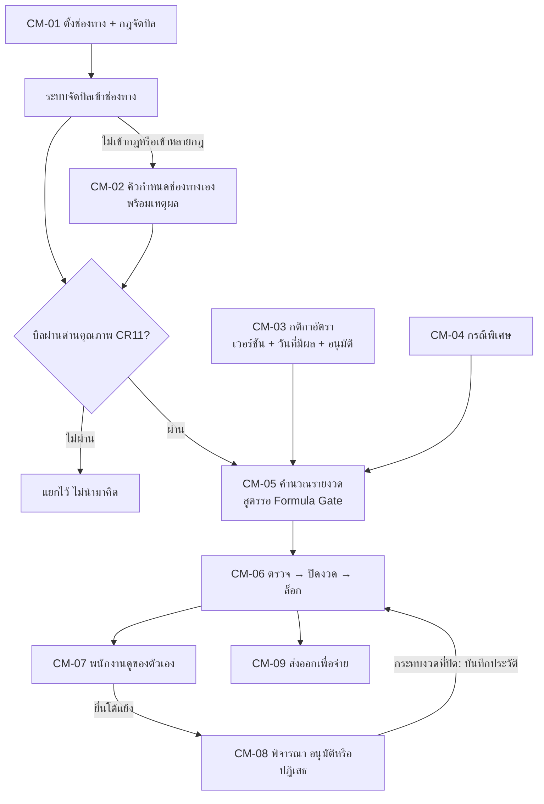

# คำนวณคอมมิชชั่น

เฟส (ข้อเสนอ v0, รอยืนยัน): 2
สถานะ: ร่างโครง v0 ผู้ใช้จะแก้ทีหลัง ยังไม่ได้ grill ทุกหน้าเป็นเขตแดง สิทธิ์ทุกปุ่มตั้งที่ตารางสิทธิ์ตำแหน่ง (`00_ระบบกลาง`)

## ขั้นตอนของระบบ

ตั้งช่องทางและกฎจัดบิลเข้าช่องทาง (CM-01) → ระบบจัดบิลที่อ่านจากชีต/HERO เข้าช่องทาง → บิลที่จัดไม่ได้หรือขัดแย้งเข้าคิวให้กำหนดเอง (CM-02) → ตั้งกติกาอัตราคอมและอนุมัติ (CM-03) → บิลที่ไม่ผ่านด่านคุณภาพข้อมูล (CR11) แยกไว้ ไม่นำมาคิด → คำนวณผลรายงวด (CM-05) → ตรวจและปิดงวดคอม (CM-06) → พนักงานดูของตัวเอง (CM-07) → ยื่นข้อโต้แย้งรายบิล (CM-07) → พิจารณา อนุมัติ/ปฏิเสธ (CM-08) → ส่งออกเพื่อจ่าย (CM-09)

## flow (แผนภาพ)

## หน้าและฟังก์ชัน

| รหัส | หน้า | ฟังก์ชันหลัก | เขต |
|---|---|---|---|
| CM-01 | ช่องทางขายและกฎจัดบิลเข้าช่องทาง | รายการช่องทาง (ส่ง/ปลีก/ออนไลน์/โครงการ/ส่งออก) กฎจัดบิล ประวัติเวอร์ชัน | แดง |
| CM-02 | บิลที่จัดช่องทางไม่ได้/ขัดแย้ง | คิวบิลที่ไม่เข้ากฎหรือเข้าหลายกฎ กำหนดช่องทางเองพร้อมเหตุผล | แดง |
| CM-03 | กติกาอัตราคอม | ตั้งอัตราตามช่องทาง/หมวด/แบรนด์/ขั้นกำไร เวอร์ชันและวันที่มีผล อนุมัติ | แดง |
| CM-04 | กรณีพิเศษ | กติกา CN/บิลคืน ขายต่ำกว่าทุน ลูกหนี้ค้างชำระ ส่วนลดเกินเกณฑ์ และรายการบิลที่เข้ากรณี | แดง |
| CM-05 | ผลคำนวณรายงวด (ก่อนปิด) | ค่าคอมต่อคน/ช่องทาง/หมวด drill-down ถึงบรรทัดบิลและกฎที่ใช้ แยกบรรทัดไม่ผ่านด่านคุณภาพ | แดง |
| CM-06 | ปิดงวดคอม | ตรวจรายการ → ปิดงวด → ล็อก เปิดให้พนักงานดูของตัวเอง ปลดล็อก | แดง |
| CM-07 | คอมของฉัน | พนักงานดูค่าคอมและรายการบิลของตัวเอง ยื่นข้อโต้แย้งรายบิล | แดง |
| CM-08 | ข้อโต้แย้งและอนุมัติ | รับข้อโต้แย้ง → พิจารณา → อนุมัติ/ปฏิเสธ พร้อมเหตุผล ผลที่กระทบงวดที่ปิดแล้วบันทึกประวัติ | แดง |
| CM-09 | ส่งออกเพื่อจ่าย | ส่งออกสรุปค่าคอมที่อนุมัติแล้ว | แดง |
| CM-10 | จำลองกติกา | ลองเปลี่ยนกติกาแล้วดูผลก่อนใช้จริง ไม่กระทบข้อมูลจริง | แดง (เฟสหลัง) |

## ค่าเริ่มต้นที่เสนอ

| เรื่อง | ค่า | สถานะ |
|---|---|---|
| คิดจากอะไร | คิดจากกำไร ไม่รวมรีเบท | ตกลงแล้ว |
| ช่องทางต่อบิล | ระบุช่องทางขายได้ต่อบิล | ตกลงแล้ว |
| บรรทัดไม่ผ่านด่านคุณภาพ | ไม่นำมาคิดคอม แยกแสดง | ตกลงแล้ว (ตามชีต CR11) |
| การเปลี่ยนกติกา | สร้างเวอร์ชันใหม่ มีวันที่มีผล ไม่แก้ทับ | ข้อเสนอ |
| พนักงานเห็นเฉพาะของตัวเอง | CM-07 ตามขอบเขตข้อมูลของตำแหน่ง | ข้อเสนอ |
| CM-10 จำลองกติกา | เฟสหลัง | ข้อเสนอ |

## ข้อมูลที่ต้องการจากผู้ใช้

"หักโครงสร้าง" รวมอะไรบ้าง · ใครแก้ต้นทุนในเมนูกำหนดราคาของ HERO · HERO บันทึกประวัติการแก้ต้นทุนไหม · เกณฑ์คุณภาพข้อมูล (ต้นทุนว่าง/0 หรือรหัสไม่อยู่ใน Master) · เนื้อหากรณีพิเศษทุกข้อ (CM-04) · ฟิลด์ที่ใช้ระบุช่องทางในบิล · รูปแบบและปลายทางของไฟล์ส่งออก (CM-09)

## สูตรที่รอ Formula Gate

อัตราคอมและค่าคอมรายงวด (CM-03, CM-05) ยังไม่มีสูตร ห้ามลงโค้ด

## เชื่อมกับ

`03_ระบบขาย` (ยอดขายและกำไร) · `00_ระบบกลาง` CR11 ด่านคุณภาพข้อมูล และ CR12 งวด · ข้อมูลคอมเป็น KPI ที่ผูกค่าตอบแทน (เขตแดง) · skill `sangwijit-commission` มีความรู้เดิมที่ควรอ่านก่อน grill
