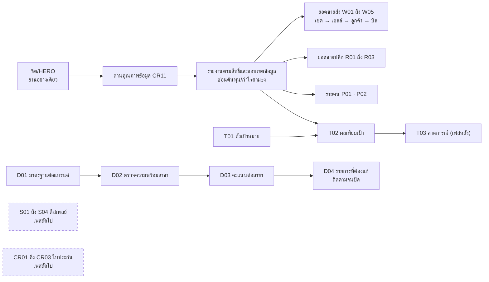

# ระบบขาย

เฟส (ข้อเสนอ v0, รอยืนยัน): 1 (ส่วนอ่านอย่างเดียว) ส่วนที่ต้องกรอกข้อมูลเลื่อนเป็นเฟสถัดไป
สถานะ: ร่างโครง v0 ผู้ใช้จะแก้ทีหลัง ยังไม่ได้ grill สิทธิ์ทุกปุ่มตั้งที่ตารางสิทธิ์ตำแหน่ง (`00_ระบบกลาง`)

## ขั้นตอนของระบบ

อ่านข้อมูลขายจากชีต/HERO (ห้ามเขียนกลับ) → ผ่านด่านคุณภาพข้อมูล (CR11) → แสดงรายงานตามสิทธิ์และขอบเขตข้อมูล โดยซ่อนต้นทุนและกำไรตามธง → drill-down เขต → เซลล์ → ลูกค้า → บิล → เป้าหมายตั้งแล้วเทียบผลจริง → งานที่ต้องแก้ติดตามจนปิด

## flow (แผนภาพ)

## หน้าและฟังก์ชัน

| กลุ่ม | รหัส | หน้า | เขต | สูตร |
|---|---|---|---|---|
| ติดตามยอดขายส่ง | SL-W01 | ภาพรวมยอดขายส่ง (เขต/เซลล์/แบรนด์/หมวด/ช่วงเวลา เทียบปีก่อน) | เหลือง | TBD |
| | SL-W02 | ยอดต่อลูกค้า drill-down | เหลือง | |
| | SL-W03 | ลูกค้าเฝ้าระวัง (หยุดซื้อ/ยอดตก/รอบสั่งขาดช่วง) | เหลือง | TBD |
| | SL-W04 | สินค้า/หมวดต่อลูกค้า (หยุดซื้อ ขายเพิ่ม) | เหลือง | TBD |
| | SL-W05 | รายละเอียดบิล (ต้นทุน/กำไรตามสิทธิ์) | เหลือง | |
| ติดตามยอดขายปลีก | SL-R01 | ภาพรวมยอดขายปลีก | เหลือง | |
| | SL-R02 | สินค้าขายดี/ค้างสต๊อก | เหลือง | TBD |
| | SL-R03 | ยอดต่อบิล/ขายพ่วง | เหลือง | TBD |
| เป้าหมาย | SL-T01 | ตั้งเป้าหมายหลายระดับ (บริษัท → สาขา/เขต → คน → หมวด) | แดง | |
| | SL-T02 | ผลเทียบเป้า | เหลือง | TBD |
| | SL-T03 | คาดการณ์สิ้นเดือน/ไตรมาส (เฟสหลัง) | เหลือง | TBD |
| ความพร้อมการขาย | SL-D01 | มาตรฐานความพร้อมต่อแบรนด์ | เหลือง | |
| | SL-D02 | ตรวจความพร้อมสาขา (ติ๊กรายการ แนบรูป) | เหลือง | |
| | SL-D03 | คะแนนความพร้อมต่อสาขา | แดง (ถ้าผูก KPI) | TBD |
| | SL-D04 | รายการที่ต้องแก้ (มอบหมาย ติดตามจนปิด) | เหลือง | |
| วิเคราะห์รายคน | SL-P01 | ผลงานรายคน (ยอด กำไร ลูกค้าใหม่ อัตราเก็บเงิน) | แดง | TBD |
| | SL-P02 | เทียบเพื่อนร่วมตำแหน่ง | แดง | TBD |
| การโชว์สินค้า | SL-S01 | มาตรฐานดีสเพลย์ | เขียว | |
| | SL-S02 | ส่งรูปดีสเพลย์ | เขียว | |
| | SL-S03 | ตรวจและให้คะแนนดีสเพลย์ | เหลือง | |
| | SL-S04 | ดีสเพลย์เทียบยอดขาย | เหลือง | TBD |
| การส่งยอดใบประกัน | SL-G01 | บันทึกบัตรรับประกัน | แดง | |
| | SL-G02 | บิลที่ยังไม่ส่งบัตร | เหลือง | |
| | SL-G03 | อัตราส่งบัตรต่อสาขา | เหลือง | TBD |

## ค่าเริ่มต้นที่เสนอ

| เรื่อง | ค่า | สถานะ |
|---|---|---|
| ส่วนอ่านอย่างเดียวในเฟส 1 | เป้า ความพร้อม รายบุคคล และรายงานยอดขาย | ตกลงแล้ว (ตามกรอบ) |
| ซ่อนต้นทุนและกำไร | ซ่อนกำไรและ % กำไรด้วยตามธง | ตกลงแล้ว |
| เฟสถัดไป | โชว์สินค้า (S) และส่งยอดใบประกัน (G) เพราะต้องกรอกข้อมูลเอง | ข้อเสนอ |
| T03 คาดการณ์ | เฟสหลัง | ข้อเสนอ |

## ข้อมูลที่ต้องการจากผู้ใช้

ความหมายคอลัมน์ต้นทุนในชีต (ต้นทุนจริง / ต้นทุนที่กำหนด / ราคากลาง) ซึ่งสำคัญมาก · วิธีตั้งเป้า (อิงปีก่อนหรือระบุตรง) · เกณฑ์ต่างๆ ที่ยังเป็นสูตร TBD

## สูตรที่รอ Formula Gate

เปรียบเทียบและ % · เกณฑ์ลูกค้าเฝ้าระวัง · ขายเพิ่ม (cross-sell) · เกณฑ์ค้างสต๊อก · ยอดต่อบิลและขายพ่วง · ผลเทียบเป้า · คาดการณ์ · คะแนนความพร้อม · KPI รายคน · เทียบเพื่อนร่วมตำแหน่ง · ดีสเพลย์เทียบยอดขาย · อัตราส่งบัตร

## เชื่อมกับ

`02_คอมมิชชั่น` (ยอดและกำไรต่อบิล) · `11_PSI` (ยอดขายย้อนหลัง) · `00_ระบบกลาง` CR11 · skill `saleout-sales-analytics` และ artifact SaleOut PSI Dashboard มีงานเดิมที่ควรอ่านก่อนสร้างซ้ำ
