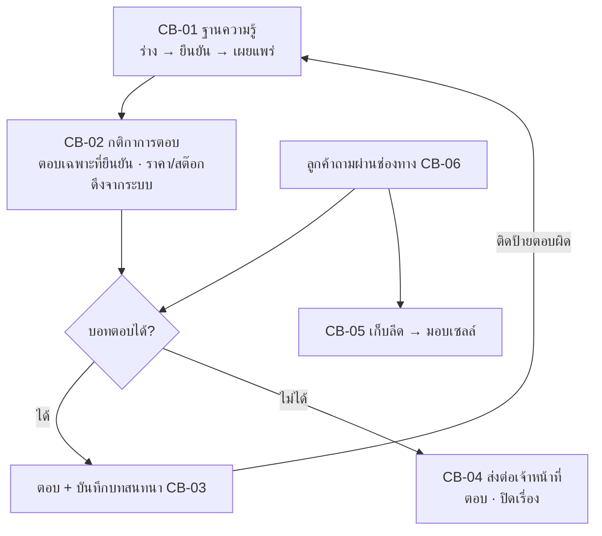

# Chatbot

เฟส (ข้อเสนอ v0, รอยืนยัน): 4
สถานะ: ร่างโครง v0 ผู้ใช้จะแก้ทีหลัง ยังไม่ได้ grill สิทธิ์ทุกปุ่มตั้งที่ตารางสิทธิ์ตำแหน่ง (`00_ระบบกลาง`)

## ขั้นตอนของระบบ

จัดการคำถาม-คำตอบ (ฉบับร่าง → ยืนยันแล้ว → เผยแพร่) → บอทตอบเฉพาะข้อมูลที่ยืนยันแล้ว ราคาและสต๊อกดึงจากระบบ ไม่ให้บอทเดา → ตอบไม่ได้หรือถึงเงื่อนไขส่งต่อเข้าคิวเจ้าหน้าที่ (CB-04) → เก็บรายชื่อผู้สนใจเป็นลีด (CB-05) แล้วมอบเซลล์ → บันทึกบทสนทนา ติดป้ายตอบผิดเพื่อนำไปแก้ฐานความรู้ (CB-03)

## flow (แผนภาพ)

## หน้าและฟังก์ชัน

| รหัส | หน้า | ฟังก์ชันหลัก | เขต |
|---|---|---|---|
| CB-01 | ฐานความรู้ | จัดการคำถาม-คำตอบ (สินค้า โปร ประกัน) สถานะฉบับร่าง/ยืนยันแล้ว เผยแพร่ | เหลือง |
| CB-02 | กติกาการตอบ | ตอบเฉพาะที่ยืนยันแล้ว ราคา/สต๊อกดึงจากระบบ เงื่อนไขส่งต่อเจ้าหน้าที่ | แดง (ราคา) |
| CB-03 | บันทึกบทสนทนา | ค้นหา/ดูบทสนทนา ติดป้ายตอบผิด | แดง (ข้อมูลส่วนบุคคล) |
| CB-04 | คิวส่งต่อเจ้าหน้าที่ | รับเรื่องที่บอทตอบไม่ได้ ตอบ ปิดเรื่อง | เหลือง |
| CB-05 | ลีดที่เก็บได้ | รายชื่อผู้สนใจ มอบเซลล์ติดตาม เปลี่ยนสถานะ | แดง (ข้อมูลส่วนบุคคล) |
| CB-06 | ตั้งค่าช่องทาง | เชื่อม LINE OA / Facebook / เว็บ | เหลือง |

## ค่าเริ่มต้นที่เสนอ

| เรื่อง | ค่า | สถานะ |
|---|---|---|
| บอทตอบเฉพาะข้อมูลที่ยืนยันแล้ว | ใช่ | ตามชีต |
| ราคา/สต๊อก | ดึงจากระบบ ไม่ให้บอทเดา | ตามชีต |
| ผู้ใช้บอท | บอทตอบลูกค้า (ภายนอก) | ข้อเสนอ ชีตยังระบุว่า TBD |

## ข้อมูลที่ต้องการจากผู้ใช้

บอทเป็นของลูกค้าหรือภายใน · ช่องทางที่ใช้จริง (LINE OA / Facebook / เว็บ) · เงื่อนไขส่งต่อเจ้าหน้าที่

## สูตรที่รอ Formula Gate

ไม่มี

## เชื่อมกับ

`05_Ecommerce` และ `00_ระบบกลาง` CR08 ข้อมูลหลักสินค้า (ราคา/สต๊อก) · `08_Ads` (ลีดต่อแคมเปญ)
