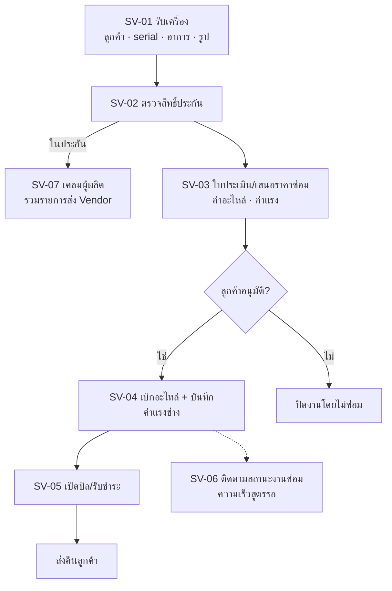

# POS ศูนย์บริการ

เฟส (ข้อเสนอ v0, รอยืนยัน): 3
สถานะ: ร่างโครง v0 ผู้ใช้จะแก้ทีหลัง ยังไม่ได้ grill สิทธิ์ทุกปุ่มตั้งที่ตารางสิทธิ์ตำแหน่ง (`00_ระบบกลาง`)

## ขั้นตอนของระบบ

รับเครื่อง (ลูกค้า สินค้า serial อาการ รูป) → ตรวจสิทธิ์ประกันจาก serial/บัตรรับประกัน → ใบประเมิน/เสนอราคาซ่อม (ค่าอะไหล่ ค่าแรง) ขออนุมัติลูกค้า → เบิกอะไหล่ตามใบงานและบันทึกค่าแรงช่าง → เปิดบิล/รับชำระ → ติดตามสถานะงานซ่อม (งานค้าง ความเร็ว) → เคลมผู้ผลิตรวมรายการส่ง Vendor

## flow (แผนภาพ)

## หน้าและฟังก์ชัน

| รหัส | หน้า | ฟังก์ชันหลัก | เขต |
|---|---|---|---|
| SV-01 | รับเครื่อง | ลูกค้า สินค้า serial อาการ แนบรูป | แดง (ข้อมูลส่วนบุคคล) |
| SV-02 | ตรวจสิทธิ์ประกัน | ค้นจาก serial/บัตรรับประกัน แสดงในประกัน/หมดประกัน | เหลือง |
| SV-03 | ใบประเมิน/เสนอราคาซ่อม | ค่าอะไหล่ ค่าแรง ขออนุมัติลูกค้า | แดง |
| SV-04 | เบิกอะไหล่และค่าแรง | เบิกอะไหล่ตามใบงาน บันทึกค่าแรงช่าง | แดง |
| SV-05 | เปิดบิล/รับชำระ | สร้างบิล/ใบกำกับภาษี บันทึกการรับชำระ | แดง |
| SV-06 | ติดตามสถานะงานซ่อม | งานค้าง ความเร็วในการซ่อม อัปเดตสถานะ | เหลือง |
| SV-07 | เคลมผู้ผลิต | รวมรายการเคลมส่ง Vendor ติดตามสถานะ | แดง |

## ค่าเริ่มต้นที่เสนอ

| เรื่อง | ค่า | สถานะ |
|---|---|---|
| ระบบใหม่ไม่ลงบัญชีและไม่คำนวณภาษี | ใบกำกับภาษีเป็นเอกสารที่ ERP หรือ HERO ออก ระบบนี้ไม่คำนวณภาษีเอง | ตกลงแล้วเรื่องไม่ลงบัญชี |
| ความรู้เดิม | ใช้ skill `sangwijit-service` (WeService, SOP รับ/ส่งงาน, เงื่อนไขประกัน, ค่าแรงและ Job Incentive) | ข้อเสนอ |

## ข้อมูลที่ต้องการจากผู้ใช้

ใครเป็นต้นฉบับของบิลและใบกำกับภาษี · ระบบนี้เป็นส่วนหน้าของ WeService ใน BC หรือเป็นระบบแยก · สูตรวัดความเร็วซ่อม

## สูตรที่รอ Formula Gate

ความเร็วในการซ่อม (SV-06) · ค่าแรง/Job Incentive ถ้าต้องคำนวณ

## เชื่อมกับ

`13_คลัง` (เบิกอะไหล่) · `14_Vendor` (เคลมผู้ผลิต) · `03_ระบบขาย` SL-G01 (บัตรรับประกัน) · `00_ระบบกลาง` CR09 (ข้อมูลลูกค้า)
