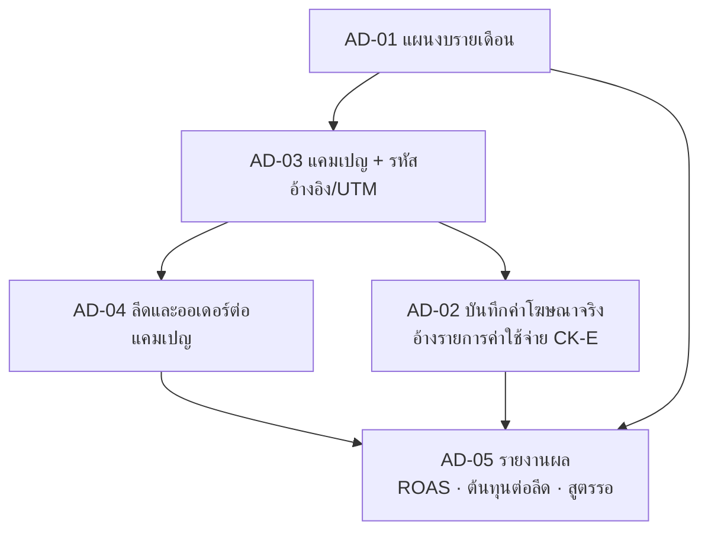

# การยิง Ads

เฟส (ข้อเสนอ v0, รอยืนยัน): 4
สถานะ: ร่างโครง v0 ผู้ใช้จะแก้ทีหลัง ยังไม่ได้ grill สิทธิ์ทุกปุ่มตั้งที่ตารางสิทธิ์ตำแหน่ง (`00_ระบบกลาง`)

## ขั้นตอนของระบบ

ตั้งแผนงบรายเดือน (ตามแบรนด์/สาขา/แคมเปญ) → สร้างแคมเปญและกำหนดรหัสอ้างอิง/UTM → บันทึกค่าโฆษณาจริงต่อแพลตฟอร์ม/แคมเปญ → ลีด ข้อความ และออเดอร์ถูกแยกตามแคมเปญ → รายงานผลโฆษณา

## flow (แผนภาพ)

## หน้าและฟังก์ชัน

| รหัส | หน้า | ฟังก์ชันหลัก | เขต |
|---|---|---|---|
| AD-01 | แผนงบรายเดือน | งบตามแบรนด์/สาขา/แคมเปญ | เหลือง |
| AD-02 | บันทึกค่าโฆษณาจริง | ค่าใช้จ่ายต่อแพลตฟอร์ม/แคมเปญ | เหลือง |
| AD-03 | แคมเปญและรหัสอ้างอิง | สร้างแคมเปญ กำหนดรหัสอ้างอิง/UTM | เขียว |
| AD-04 | ลีดและออเดอร์ต่อแคมเปญ | ลีด/ข้อความ/ออเดอร์แยกตามแคมเปญ | เหลือง |
| AD-05 | รายงานผลโฆษณา | ROAS ต้นทุนต่อลีด ยอดขายจากโฆษณา | เหลือง |

## ค่าเริ่มต้นที่เสนอ

| เรื่อง | ค่า | สถานะ |
|---|---|---|
| ค่าโฆษณาจริงกับเงิน | เงินจ่ายผ่านค่าใช้จ่าย (`01_เช็คลิส`) ที่เดียว หน้า AD-02 อ้างอิงรายการนั้นเหมือนกับทะเบียนรถ | ข้อเสนอ |
| รหัสอ้างอิง | ใช้รหัสแคมเปญชุดเดียวทั้ง Ads, Chatbot และออเดอร์ | ข้อเสนอ |

## ข้อมูลที่ต้องการจากผู้ใช้

วิธีผูกยอดกลับจากการซื้อที่หน้าร้าน (ชีตระบุว่าทำได้ยาก TBD) · แพลตฟอร์มที่ใช้ยิงจริง

## สูตรที่รอ Formula Gate

ROAS · ต้นทุนต่อลีด · ยอดขายจากโฆษณา (AD-05)

## เชื่อมกับ

`01_เช็คลิส` (ค่าใช้จ่าย) · `04_Chatbot` (ลีด) · `05_Ecommerce` (ออเดอร์ออนไลน์) · `03_ระบบขาย`
