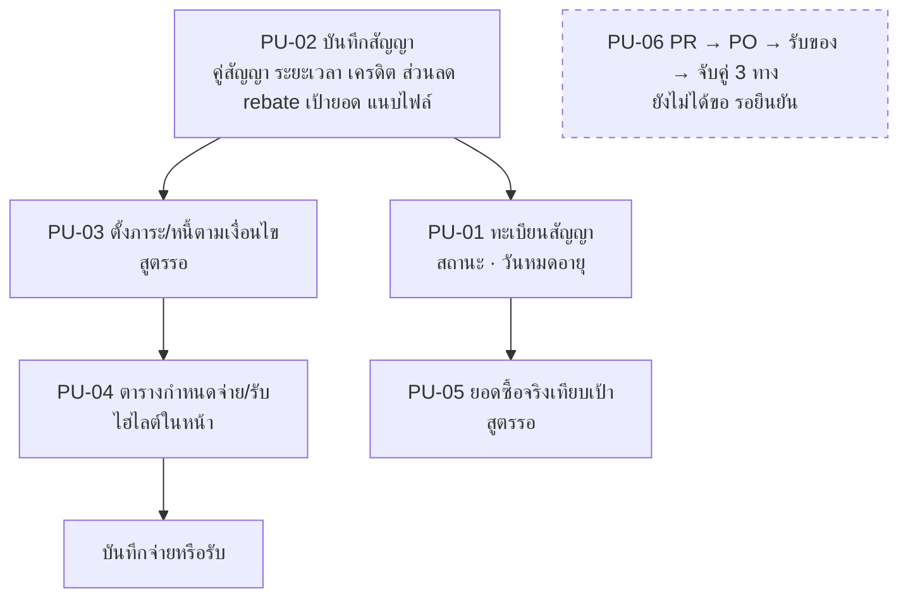

# ระบบจัดซื้อ

เฟส (ข้อเสนอ v0, รอยืนยัน): 2
สถานะ: ร่างโครง v0 ผู้ใช้จะแก้ทีหลัง ยังไม่ได้ grill สิทธิ์ทุกปุ่มตั้งที่ตารางสิทธิ์ตำแหน่ง (`00_ระบบกลาง`)

## ขั้นตอนของระบบ

บันทึกสัญญา (คู่สัญญา ระยะเวลา เครดิต ส่วนลด rebate เป้ายอด แนบไฟล์) → ตั้งภาระ/หนี้ตามเงื่อนไข (เช่น rebate ที่คาดว่าจะได้) → ตารางกำหนดจ่าย/รับ ไฮไลต์ในหน้า (ไม่แจ้งเตือน) บันทึกจ่าย/รับ → ยอดซื้อจริงเทียบเป้าตามสัญญา → ทะเบียนสัญญาแสดงสถานะและวันหมดอายุ

## flow (แผนภาพ)

## หน้าและฟังก์ชัน

| รหัส | หน้า | ฟังก์ชันหลัก | เขต |
|---|---|---|---|
| PU-01 | ทะเบียนสัญญา | ค้นหา/กรองสัญญา ดูสถานะ/วันหมดอายุ | เหลือง |
| PU-02 | บันทึก/แก้สัญญา | คู่สัญญา ระยะเวลา เครดิต ส่วนลด rebate เป้ายอด แนบไฟล์สัญญา | แดง |
| PU-03 | ภาระ/หนี้จากสัญญา | ตั้งภาระตามเงื่อนไข | แดง |
| PU-04 | ตารางกำหนดจ่าย/รับ | วันครบกำหนดจ่าย/รับ ไฮไลต์ในหน้า บันทึกจ่าย/รับ | เหลือง |
| PU-05 | ยอดซื้อเทียบเงื่อนไข | ยอดซื้อจริงเทียบเป้าตามสัญญา | แดง |
| PU-06 | PR → PO → รับของ → จับคู่ 3 ทาง | ใบขอซื้อ อนุมัติ ใบสั่งซื้อ รับของ จับคู่กับใบแจ้งหนี้ | แดง (นอกลิสต์เดิม) |

## ค่าเริ่มต้นที่เสนอ

| เรื่อง | ค่า | สถานะ |
|---|---|---|
| ขอบเขต | บันทึกสัญญาพร้อมตั้งหนี้ ไม่ลงบัญชี การลงบัญชีละเอียดอยู่ที่ ERP | ตกลงแล้ว |
| PU-06 | **ผู้ใช้ยังไม่ได้ขอ** จึงไม่ทำจนกว่าจะยืนยัน | ตามชีต |
| การแจ้งเตือนวันครบ | ไฮไลต์ในหน้า ไม่แจ้งเตือน (เฟส 1 ถึง 2) | ตกลงแล้ว |

## ข้อมูลที่ต้องการจากผู้ใช้

ยืนยันว่าต้องการ PU-06 หรือไม่ · ถ้าทำ PU-06 ใครเป็นต้นฉบับเอกสาร (HERO หรือระบบใหม่) · แหล่งข้อมูลสัญญาเดิม

## สูตรที่รอ Formula Gate

ภาระจากสัญญา เช่น rebate ที่คาดว่าจะได้ (PU-03) · ยอดซื้อเทียบเงื่อนไข (PU-05)

## เชื่อมกับ

`13_คลัง` WH-01 (รับสินค้าเทียบ PO) · `11_PSI` (ใบเสนอสั่งซื้อ) · `14_Vendor` (PO และใบขอราคา) · `01_เช็คลิส` ค่าใช้จ่าย (การจ่ายตามกำหนด) · skill `sangwijit-purchasing` มีความรู้เดิมที่ควรอ่านก่อน grill
