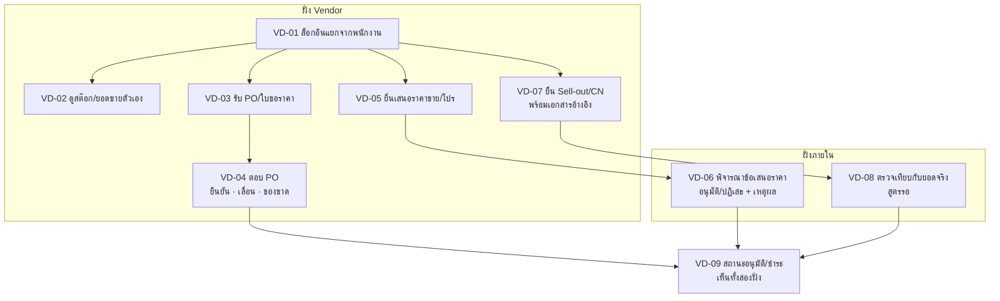

# ระบบ Vendor

เฟส (ข้อเสนอ v0, รอยืนยัน): 4
สถานะ: ร่างโครง v0 ผู้ใช้จะแก้ทีหลัง ยังไม่ได้ grill ทุกหน้าเป็นเขตแดง สิทธิ์ทุกปุ่มตั้งที่ตารางสิทธิ์ตำแหน่ง (`00_ระบบกลาง`)

## ขั้นตอนของระบบ

ฝั่ง Vendor (บุคคลภายนอก): ล็อกอินแยกจากพนักงาน → ดูสต๊อกและยอดขายของสินค้าตัวเอง → รับ PO/ใบขอราคา → ตอบ PO (ยืนยัน/เลื่อนวันส่ง/แจ้งของขาด) → ยื่นเสนอราคาขาย/โปร → ยื่น Sell-out/CN พร้อมเอกสารอ้างอิง

ฝั่งภายใน: พิจารณาข้อเสนอราคา เทียบราคาปัจจุบัน อนุมัติ/ปฏิเสธพร้อมเหตุผล → ตรวจข้อเสนอ Sell-out/CN เทียบกับยอดขายจริง → ติดตามสถานะอนุมัติ/ชำระรายข้อเสนอ ทั้งสองฝั่งเห็นสถานะเดียวกัน

## flow (แผนภาพ)

## หน้าและฟังก์ชัน

| รหัส | ฝั่ง | หน้า | ฟังก์ชันหลัก | สูตร |
|---|---|---|---|---|
| VD-01 | Vendor | เข้าสู่ระบบ Vendor | ล็อกอินแยกจากพนักงาน | |
| VD-02 | Vendor | สต๊อกและยอดขายของ Vendor | สต๊อกต่อสาขา ยอด Sell-out อัตราหมุน เห็นเฉพาะสินค้าตัวเอง | อัตราหมุน TBD |
| VD-03 | Vendor | PO/ใบขอราคาที่ได้รับ | ดูของตัวเอง | |
| VD-04 | Vendor | ตอบ PO | ยืนยัน/เลื่อนวันส่ง/แจ้งของขาด สถานะแสดงสองฝั่ง | |
| VD-05 | Vendor | ยื่นเสนอราคาขาย/โปร | ส่งราคา โปร เงื่อนไขใหม่ ประวัติราคาและเวอร์ชัน | |
| VD-06 | ภายใน | พิจารณาข้อเสนอราคา | ฝ่ายจัดซื้อเทียบกับราคาปัจจุบัน อนุมัติ/ปฏิเสธพร้อมเหตุผล | |
| VD-07 | Vendor | ยื่น Sell-out/CN | ยื่นข้อเสนอ Sell-out/ค่าสนับสนุน/CN พร้อมเอกสารอ้างอิง | |
| VD-08 | ภายใน | ตรวจเทียบกับยอดจริง | เทียบข้อเสนอกับยอดขายจริง อนุมัติ/ปฏิเสธ | TBD |
| VD-09 | ทั้งสองฝั่ง | สถานะอนุมัติ/ชำระ | ติดตามสถานะรายข้อเสนอ | |

ทั้งหมดเป็นเขตแดง

## ค่าเริ่มต้นที่เสนอ

| เรื่อง | ค่า | สถานะ |
|---|---|---|
| ข้อห้ามของ Vendor | ห้ามเห็นต้นทุนและข้อมูลของ Vendor อื่น | ตามชีต |
| บัญชี Vendor | เป็นผู้ใช้อีกประเภท (ภายนอก) ที่ผูกกับบริษัท Vendor และมีขอบเขตข้อมูลเฉพาะสินค้าของบริษัทนั้น ใช้ตารางสิทธิ์ชุดเดียวกับ core | ข้อเสนอ ชีตระบุว่า TBD |
| ผู้สร้างรหัส Vendor | แอดมินสร้างผ่าน CR04 เหมือนผู้ใช้อื่น | ข้อเสนอ |

## ข้อมูลที่ต้องการจากผู้ใช้

Vendor เป็น "บุคคล" หรือผู้ใช้อีกประเภท (ผลต่อโครงสร้างผู้ใช้ใน CR04) · รายชื่อ Vendor ที่จะให้ใช้ · เอกสารอ้างอิงที่ต้องแนบในการยื่น Sell-out/CN

## สูตรที่รอ Formula Gate

อัตราหมุน (VD-02) · การตรวจเทียบ Sell-out/CN กับยอดจริง (VD-08)

## เชื่อมกับ

`12_จัดซื้อ` (PO ใบขอราคา) · `11_PSI` · `06_POS-ศูนย์บริการ` SV-07 (เคลมผู้ผลิต) · `07_E-learning` (คอร์สจาก Vendor) · `00_ระบบกลาง` CR04 CR05 (ผู้ใช้ภายนอก) · artifact Vendor Partnership Meeting 2027 (9 ต.ค.) มีบริบทของงาน
